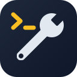

<p align="center"></p>

# agentic-toolsmith

> Satellite tooling for coding agents: command-line access to a running project, from outside it.

`toolsmith` is a skill for coding agents. In Brooks's surgical team, the toolsmith builds the
instruments the surgeon operates with; this skill makes the agent the project's toolsmith.

Agent loops do their best inside the ecosystem they are given. The bigger lever is usually the
ecosystem itself: can an agent launch the app, log in as a persona, put it in a given state, look
inside its live process, read what it wrote and sent, screenshot a named state — **from the
command line, without a human?** Toolsmith maps what exists and what is missing, compiles it into a
roadmap, reviews it with you remark by remark, then builds and proves the handles you accept.

It changes the codebase only where a handle needs it — a hook, an API to expose, a fence. The heart
of the work is the tooling around the code, not the code.

**What it is not.** Repo-readiness checkers (Factory's Agent Readiness, AGENTS.md generators and
audits) score the repository's hygiene — instructions, tests, conventions. Toolsmith builds the
instruments around a running project. They are complementary; toolsmith writes only its own "How to
reach the app" section into the agent file and leaves the rest to them.

## Three scopes

- `/toolsmith map` — the whole app: every boundary, a roadmap, milestones.
- `/toolsmith task "<fix or feature>"` — the task as a use case: which **durable** handles would
  make tasks like it reachable and verifiable. It does not do the task, and builds nothing
  ephemeral — one-off helpers are the coding agent's inline work.
- `/toolsmith want "<capability>"` — "direct DB access from the CLI": the handle designed properly,
  or the request challenged when a safer, more useful shape exists.

Every scope writes into the same project map and roadmap.

## Map first, if you want

`/toolsmith map` is a planner pass with no task: the agent charts **every boundary of the app** —
UI, process, runtime, internal seams, state stores, egress, ingress, time, identity, platform,
delivery, telemetry, configuration — and at each inspection point, what an agent could **see,
steer, stub, freeze or check** there today. Candidate handles come first; safety only as the few fences those handles need. You get a diagram and a table of where tooling could apply, grilled with
you, before any tool is proposed. Later runs read the map instead of rediscovering it.

## The evidence grid — four levels × three ways

The question behind every map: **at each level of this app, what can an agent prove, and how?**

| | **Bring out** — a lab | **Witness** — the effects | **Reach in** — the live app |
|---|---|---|---|
| **unit** — a function, a query | unit tests, rolled-back SQL tests | the rows a unit wrote, asserted | — |
| **piece** — a screen, a scene, a model | a component or region lab, a scene harness | the calls a piece makes | a screenshot of it in the running app |
| **operation** — a request, a job, a webhook | one operation driven alone, on a local stack | what one operation wrote, called, bypassed | call it, as a persona |
| **journey** — the whole app, as someone | e2e with the outside world replaced | what a whole session touched | launch, log in, reach the state |

Agents fill one cell — the whole app, reached live — and call the rest covered because a unit suite
and an e2e suite exist. The **piece** row (between those two suites) and the **witness** column (what
the code touched, not what the screen shows) are where maps go blank. So every cell gets a verdict,
graded by whether its evidence can fail against something written down — `observed` · `asserted` ·
`gated` — or `gap` / `n/a` with why. **A gap is not a proposal**: it becomes a card only when the
project needs it, and what the project needs is read from its own history — the **task mix**, the
last commits sorted by level — which also decides the first milestone. A screen-heavy project may
start with a lab that needs no launch; a backend-heavy one with a witness on one operation;
launching the app and logging in comes first only where whole-app journeys dominate.

The strong form of any cell is a **declared boundary**: declare what a piece can be or what an
operation may touch, run each declared state in isolation, witness the run, fail on the difference,
review the declaration's diff, and tie it back to the live app. Toolsmith proposes it as a pattern
built on the project's own seams, or with whichever tool fits.

Every handle is also judged on two properties: **loop** (fast, parallel-safe, resettable —
environments, containers and displays live here, not in the lab) and **fence** (dev-only, fails
closed). Each handle gets a coordinate — **cell (level × way) · boundary · verb** — and a quality
bar. On the review page, the grid comes first, with every proposed card drawn in its cell; the
app's handles are then drawn by where they attach (launch, ingress, runtime, state, egress, eyes,
and the lab framing them).

## Install — one command

```sh
curl -fsSL https://raw.githubusercontent.com/Scorbutics/agentic-toolsmith/main/install.sh | bash
```

Detects your agents and installs for each one found: Claude Code (`~/.claude/skills/toolsmith`) and
GitHub Copilot — CLI, VS Code or JetBrains (`~/.copilot/skills/toolsmith`); Claude Code if none is found.
Force the choice with `--claude`, `--copilot` or `--all` (pass options with `| bash -s -- --copilot`).
`--project` installs into this project instead (`.claude/skills/`, `.github/skills/`); also `--dir DIR`,
`--ref REF`, `--uninstall`. From a clone: `./install.sh`. With the skills CLI:
`npx skills add Scorbutics/agentic-toolsmith`.

Then, in any project, start your agent and type `/toolsmith map`.

## Test it — one command

```sh
git clone https://github.com/Scorbutics/agentic-toolsmith && cd agentic-toolsmith
./evals/run.sh --only vue-realworld          # one scenario, sonnet, with the skill and without
./evals/run.sh --model sonnet --model haiku  # every scenario, two models
./evals/run.sh --judge                       # and where the proposals fall on the evidence grid
./evals/run.sh --runs 3 --skill <dir> --judge   # three runs per cell, any version of the skill
python3 evals/judge.py runs/a --agreement    # judge every map twice: how far to trust the judge
```

Six public repositories, one per shape — a Rails monolith (CodeTriage), a Go service (miniflux), a
Vue SPA (vue-realworld), a dbt pipeline (jaffle-shop), a Godot game (tps-demo), a Next.js + Supabase +
Stripe starter (subscription-payments) — pinned to a commit.
Each runs the Claude Code CLI headless on the same task **with the skill and without it**, read-only,
and scores both outputs on the scenario's expected behaviours (did it pick the right primitive for
where the state lives? a mock API for the SPA? DuckDB as the lab for dbt?), the runnable usage
examples, the roadmap, and whether cited `file:line` references resolve. Results land in
`eval-runs/<timestamp>/results.md`. With `--judge`, a judge model then classifies every proposal by
level and way (`distribution.md`): how many grid cells the proposals reach, the share of the busiest
cell, M1's cell, and any of the author's tools proposed where the scenario says they do not fit —
what keyword scores cannot see. The task prompt names no way of working (`--prompt ladder` keeps the
old wording, which listed the reach-in steps for every arm). Scores against **answer keys** —
what a person who read each repository says a good map should and should not propose
([evals/answer-keys/](evals/answer-keys/README.md)) — appear once the keys are filled.

**Latest results** ([docs/evals.md](docs/evals.md)): six repositories, Sonnet and Haiku, three runs
each, a prompt that names no way of working, every map judged twice. With the evidence grid, the
first milestone is "set up environments and launch" in **1 of 36** maps (23/36 with the skill before
the grid, 20/36 without any skill); witness reaches 23–29 % of the cells a map covers (3–11 % without
the skill); expected behaviours 211/216 (112/216 without). Not yet fixed: the first milestone lands
in a different cell from one run to the next on the same repository. The earlier keyword run, on five repositories: with the skill, **57/60** expected behaviours versus
**40/60** without, a roadmap in 10/10 runs versus 0/10, about 9 runnable usage examples per map versus
none, and 94 % of cited `file:line` resolving — on Sonnet and on Haiku. Needs `git`, `python3` and a logged-in `claude` CLI; each run is a
real agent session of several minutes.

## What it is not

- Not *Agent Experience* (AX) in Netlify's sense — that is about agents as **users of your
  product** (can an agent discover and call your API?). This is about agents as **developers
  of your product** (can an agent reach the app it is changing?).
- Not Browserbase's `agent-experience` skill — that grades how easily an outside agent onboards
  onto your docs/SDK. This measures the agent's reach into your running app and builds what's missing.
- Not an agent that writes its own tools at runtime ("LLMs as tool makers"). The tools are
  dev-only handles into *your app*, reviewed and committed like any other code.
- Not a product. The skill recommends whichever handle fits — often one your project half-has.

## Prior art

Research and practice:

- **SWE-agent: Agent-Computer Interfaces Enable Automated Software Engineering** — Yang et al.,
  NeurIPS 2024 ([arXiv:2405.15793](https://arxiv.org/abs/2405.15793)). The ACI term, and the
  evidence that interface design moves agent results.
- **Building effective agents** — Anthropic (2024): invest in the agent-computer interface as
  much as in human-computer interfaces.
- **Writing effective tools for agents** — Anthropic (2025): concise, meaningful, actionable output.
- **Effective harnesses for long-running agents** — Anthropic
  ([post](https://www.anthropic.com/engineering/effective-harnesses-for-long-running-agents)):
  an `init.sh` that starts the app and a basic end-to-end check *before* any feature work.
- **Harness engineering: leveraging Codex in an agent-first world** — OpenAI, Feb 2026
  ([post](https://openai.com/index/harness-engineering/)): make UI, logs and metrics directly
  legible to the agent; per-worktree observability.
- **Agent Experience (AX)** — Mathias Biilmann / Netlify, 2025
  ([page](https://www.netlify.com/agent-experience/)): agents as a first-class audience.
- **grill-me** — Matt Pocock ([skill](https://www.skills.sh/mattpocock/skills/grill-me)): one
  question at a time, look in the codebase before asking.
- **The Mythical Man-Month** — Fred Brooks (1975): the surgical team and its toolsmith.

Two tools by the same author, each a declared boundary in one cell of the grid — the same pattern
the skill proposes on any stack. The skill does not require them: it recommends a tool — these, Storybook, Mailpit, OpenTelemetry or a few lines of project
code — only when the app's map shows it fits, with the alternative and the cost, and it always
discloses these two as the author's ([tools.md](skills/toolsmith/references/tools.md)):

- **[motu](https://github.com/Scorbutics/motu)** — *piece × bring out (and the calls a piece makes).* Declare a screen region's state and
  owners; the lagoon renders every declared state at its own URL, with no backend and no login,
  and checks keep the lab and the page in agreement.
- **[assay](https://github.com/Scorbutics/assay)** — *operation × witness.* An effect ledger: what each
  backend operation actually touches (tables, procedures, outbound hosts, access-control bypass),
  and a gate that fails when it differs from what was declared.

## Layout

```
skills/toolsmith/
  SKILL.md                      the process: trace → survey → verify boundary → probe → grill → rank → build → prove
  references/grid.md            the evidence grid: levels × ways, grading a cell, the declared boundary, loop and fence
  references/map.md             map mode: task mix, 13 boundary classes × 5 verbs (see, steer, stub, freeze, check), the grid
  references/map-template.md    the map, with its diagram
  references/shapes.md          what each rung means per project shape
  references/handles.md         handles by rung: reach in, lab, witness, assert, launch/reset
  references/tools.md           fitting an existing tool: evidence, alternative, cost, disclosure
  references/grill.md           question bank
  references/report-template.md the deliverable
  references/scopes.md          task and capability scopes
  references/review.md          the review loop: present, answer every remark, revise, accept, implement
  scripts/review_page.py        map.md → one self-contained HTML review page (stdlib only)
tests/test_review_page.py       regression tests for the review page: python3 -m unittest discover -s tests
evals/run.py, evals/judge.py    evals with and without the skill; the grid distribution of the proposals
docs/trials.md                  dry runs on four project shapes, and what each changed
```

## Status

**v0.1.** Tested with **Claude Code** (Opus, Sonnet, Haiku): evals on five public repositories
([docs/evals.md](docs/evals.md)), dry runs and real builds on several private projects
([docs/trials.md](docs/trials.md)). **GitHub Copilot** support (`install.sh --copilot`, `AGENTS.md`)
follows Copilot's documented conventions but is not tested yet. Feedback from other project shapes
and other agents is the most useful contribution.

## License

MIT
