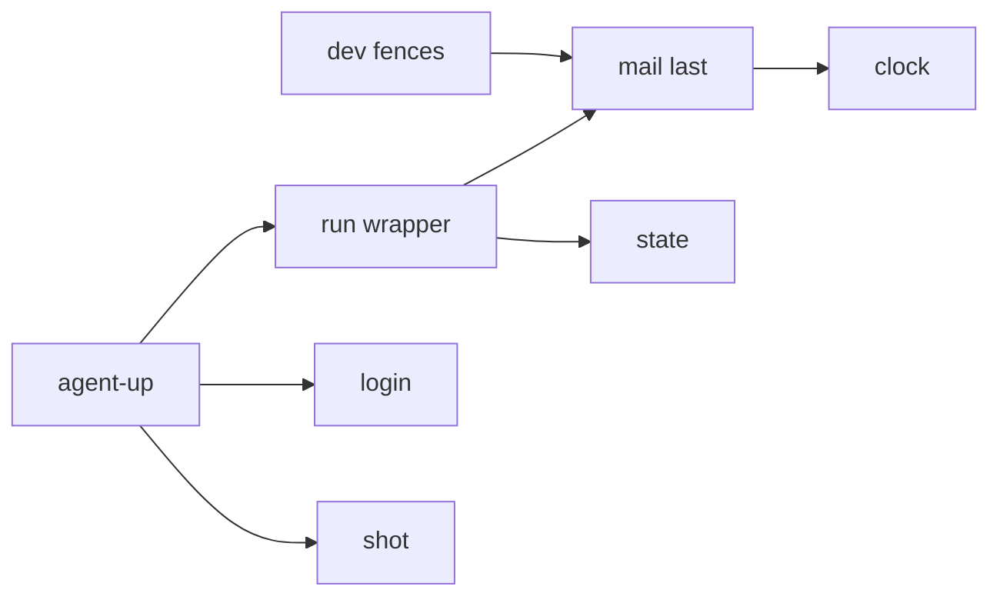
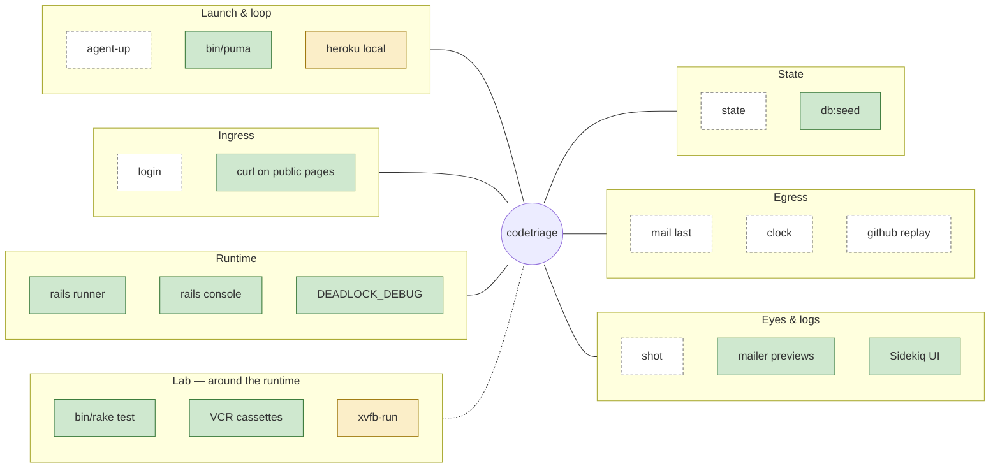

# Agent map — codetriage @ d1868f8 (2026-11-24)

## Contents
- Parallel agents
- Tools already in place
- Capabilities
- Delivered handles
- Candidate handles (not built)
- Deferred handles
- Roadmap
- Transferable patterns
- Rules → guards
- Fences to set first
- Diagram
- Points
- Classes with no point
- Unknowns
- Decisions
- Revisions
- Accepted plan
- Grill
- Noticed in passing

**Shape(s):** Rails 8.1 web app (`Gemfile:5`, `.ruby-version`) with a Sidekiq worker, PostgreSQL, Redis, Devise + GitHub OAuth (`config/initializers/devise.rb:208`) · **Repos covered:** codetriage (single repo; paths are repo-relative) · **Mapped by:** toolsmith map scope, run without a human; **not grilled**. The review loop (steps 6–10) was not run: no one was available to answer remarks, so every status below is `proposed` and nothing is built.

**Variants:**
- **dev** — `Procfile.development` (`web: bin/puma`, `worker: sidekiq`; `Procfile.development:1-2`), port 3000 by default (`config/puma.rb:14`). The only variant where a local agent run is meant to happen. Mail and GitHub are live here (see Fences).
- **test** — `RAILS_ENV=test`; mail is `:test` (`config/environments/test.rb:45`), network is blocked unless a VCR cassette is open (`test/test_helper.rb:59`). Handles that run the suite belong here.
- **production** — Heroku (`heroku.yml`, `app.json`, `Procfile:1-3`); memcache, SendGrid, Sentry, S3 sitemap. No agent handle should ever point here.
- Dev-only handles: the `PROFILE` switch (`config/environments/development.rb:11`), the `tmp/caching-dev.txt` cache toggle (`development.rb:21`), the browser error console from `web-console` (`Gemfile:106`, docs).

**In one paragraph:** An agent can run the test suite, lint, and any Rails runner or rake task against a local database, and it can read the code thoroughly. It cannot start the app without a human (no launch script, no `config/database.yml` in the checkout, `heroku` is not on this PATH, and `CONTRIBUTING.md:103` assumes it). It cannot sign in as anyone other than through GitHub OAuth, it cannot see what mail or GitHub calls left the process, and it cannot freeze or move the clock, so the daily schedule tasks run only on their weekday guard. The three changes that matter most: a one-command isolated launch (C1), a persona login handle (C2), and a capture of outbound mail and GitHub calls with fail-closed fences (C4). Time control (C3) follows from the runner once the mail fence exists.

## Parallel agents

**Agents that can safely work at once today: 1** — one local `triage_development` database (`config/database.example.yml:10`), one `triage_test` (`:14`), default port 3000 (`config/puma.rb:14`), one Redis for Sidekiq (`config/initializers/sidekiq.rb:4`, `REDIS_URL` unset in the checkout), and shared seed rows. Two agents would collide on the first DB write.

| Shared resource | Shared by | What collides | Isolation today | Proposal (level 1 · 2 · 3) |
|---|---|---|---|---|
| PostgreSQL `triage_development` | every dev run | schema, seed rows, anything an agent writes | none (names fixed in `config/database.example.yml:10`) | level 1: `triage_<env>` derived from the env name · 2: separate schema per env · 3: cloned DB per run |
| PostgreSQL `triage_test` | every `bin/rake test` | fixture load deletes and reloads the same tables (`test/test_helper.rb:` `fixtures :all`) | none | level 1: `TEST_ENV_NUMBER`-style suffix (Rails parallel tests, docs) · 2: one DB per worktree |
| port 3000 | every dev server | the second `bin/puma` fails to start (`config/puma.rb:14`) | none | level 1: `PORT` from `--env` (the env already reads `PORT`) · 2: a registry of ports |
| Redis / Sidekiq queues | dev worker and any runner that enqueues | one worker consumes another run's jobs (`Procfile.development:2`, `-q default -q mailers`) | none (`config/initializers/sidekiq.rb:4`) | level 1: Redis DB index per env (`REDIS_URL` path suffix) · 2: a queue name per env |
| `tmp/get_process_mem` clone | `db:seed` | seeds clone into `tmp/` (`db/seeds.rb:22`), second run reuses it | none | level 1: per-env `tmp/<env>/` |
| global seed rows | `db:seed` | user `schneems` and repo `get_process_mem` are fixed (`db/seeds.rb:16-17`); a second seed run writes the same rows | none | level 1: persona rows keyed by env name |
| VCR cassettes | `bin/rake test` in record mode | files in `test/vcr_cassettes` are git-tracked; a record run rewrites them (`CONTRIBUTING.md:158`) | none | level 1: read-only in agent runs (replay only) |
| GitHub API token | every dev run that hits GitHub | rate limit on one `GITHUB_API_KEY` | none | level 1: agent runs use replay or a dedicated token |
| `log/development.log` (Rails default, docs) | every dev run | interleaved lines | none | level 1: `log/<env>.log` |

## Tools already in place

Every handle an agent could already call before toolsmith built anything. One row per verb.

| Tool | Category | Verb | Way | Point(s) | Usage |
|---|---|---|---|---|---|
| Rails runner (docs) over app code | runtime | steer | reach in | B3, B5 | `bin/rails runner 'p User.count'` (in a fresh process, not the running server) |
| Rails console | runtime | see, steer | reach in | B3, B5 | `bin/rails c` — `Procfile.concurrency:1` declares it; it is a separate process |
| rake tasks — schedule | egress | steer | reach in | B6, B7, B8 | `bin/rake schedule:triage_emails` (`lib/tasks/schedule.rake:5`); most tasks exit at once on the wrong weekday (`schedule.rake:56, 99, 107`) and the triage task sends real mail through the live provider |
| rake tasks — DB seed | state | steer | reach in | B5, B6 | `bin/rails db:seed` — also clones a GitHub repo and calls GitHub (`db/seeds.rb:22`) |
| test suite | lab (gate) | check | witness | B3, B6, B9 | `bin/rails test test/unit/user_test.rb` runs one file (Rails convention, docs); `bin/rake test` runs all 49 files (`test/**/*_test.rb`) |
| VCR cassettes | lab | steer | stub | B6 | replay of 30 recorded GitHub responses in `test/vcr_cassettes`, used by `bin/rake test` (`test/test_helper.rb:59-61`) |
| standardrb | lab (gate) | check | witness | B11 | `bundle exec standardrb` (`.github/workflows/main.yml:29`) |
| `DEADLOCK_DEBUG` | runtime | see | reach in | B3 | `DEADLOCK_DEBUG=5 bin/rake <task>` prints every thread's backtrace every N seconds (`Rakefile:6-9`); rake processes only, not puma |
| `PROFILE` switch | config | steer | reach in | B13 | `PROFILE=1 bin/rails s` makes dev prod-like (eager load, stdout log) (`config/environments/development.rb:11,14`) |
| Sidekiq web UI | telemetry | see | eyes (browser) | B12 | `/sidekiq`, admin only (`config/routes.rb:10`); needs a signed-in admin, so no agent path |
| Mailer previews | eyes | see | eyes (browser) | B6 | `/rails/mailers` (`config/routes.rb:52`) renders `test/mailers/previews/user_preview.rb` — renders only, sends nothing |
| rack-mini-profiler | eyes | see | eyes (browser) | B12 | page overlay (`Gemfile:79`); Redis storage in production (`config/initializers/mini-profiler.rb:6`) |
| web-console | runtime | steer | reach in (browser) | B3 | an in-page console on error pages in dev (`Gemfile:106`, docs) |
| Procfile + foreman-style launcher | launch | steer | reach in | B2 | `heroku local -f Procfile.development` (`CONTRIBUTING.md:103`); `heroku` is **not** on this PATH |
| `bin/setup`, `bin/update` | launch | steer | reach in | B2, B5 | install gems, `db:setup`, clear logs, restart (`bin/setup`); `db:setup` loads the schema — not agent-safe on an existing DB |
| `bin/puma` | launch | steer | reach in | B2 | `bin/puma -C config/puma.rb` (`Procfile.development:1`); `plugin :tmp_restart` (`config/puma.rb:17`) |
| Rails logs | telemetry | see | witness | B12 | `log/` holds only `.gitkeep` (no log yet); Rails writes `log/development.log` by default (docs) |
| psql / redis-cli on PATH | state | see, steer | reach in | B5 | `/usr/bin/psql`, `/usr/bin/redis-cli` present; not run here |
| curl / jq on PATH | ingress | steer, see | reach in | B7 | `/usr/bin/curl`, `/usr/bin/jq` present; useful only for unauthenticated pages |
| xvfb-run on PATH | lab | steer | stub (display) | B10 | `/usr/bin/xvfb-run` present; no browser binary found on PATH (chromium, google-chrome absent) |

## Capabilities

The backbone of the roadmap: what the agent cannot do today on this project.

| # | Capability — the agent can… | Today | Evidence |
|---|---|---|---|
| C1 | run the loop unattended: launch an isolated copy, reach a state, see it, check it | a human configures the DB, starts Postgres/Redis/Procfile, and reads the screen | no `config/database.yml` in the checkout (`.gitignore:29`; `config/` lists only `database.example.yml`, `database.ci.yml`); `CONTRIBUTING.md:78-79, 103, 108`; `heroku` not on PATH; no `.env` present |
| C2 | reach any state as any persona, without typing a password | seeds create one named user `schneems` (`db/seeds.rb:16`) plus Faker users; login is GitHub OAuth only (`config/initializers/devise.rb:208`); a human clicks "sign in" (`CONTRIBUTING.md:118`); admin is a boolean column (`db/schema.rb:170`, checked by `app/controllers/application_controller.rb:9`) | B9 evidence above; test-only helper `test/test_helper.rb:73` (`login_via_github`, OmniAuth mock) |
| C3 | reach any state at any time: run the weekly and daily jobs at a chosen moment | `Time.now` in six places (`app/models/user.rb:77,175,183`; `app/controllers/doc_methods_controller.rb:44`; `app/jobs/send_daily_triage_email_job.rb:43`); `Date.today` guards in `lib/tasks/schedule.rake:56, 99, 107`; no clock seam | B8 points |
| C4 | check what left the app: see every mail and every GitHub or git call a run made, and have a dev run fail closed | mail goes to live SendGrid in every environment when credentials are set (`config/initializers/mail.rb:4-11`); GitHub is live in dev (`app/models/issue.rb:11`); nothing records outbound traffic | B6 points; `config/environments/development.rb:39` `raise_delivery_errors = false` hides failures |

**Today** says what happens instead. Each capability is delivered by a milestone below.

## Delivered handles

None. Nothing was built; this map was run read-only.

## Candidate handles (not built)

Primitive decision (principles, step 0): the state lives in PostgreSQL and Redis, outside the web process. **Primitive = a script runner over the app's own code**: `bin/rails runner scripts/agent/<name>.rb` (or a `scripts/agent/run` wrapper). Everything below is a script under that primitive unless its card says why not.

Cards whose handle cannot be a runner script: `agent-up` (must create the stack the runner needs), `login` (the session cookie is minted by the running server), `shot` (a browser lives outside any Ruby process).

### `agent-up` — launch · B2 Process · steer · reach in · cost M
**Status:** proposed
**Is:** a new `scripts/agent/up` (bash) that writes `config/database.yml` from `config/database.example.yml` if missing, creates `triage_<env>`, loads `db/schema.rb`, runs `db:seed`, and starts `bin/puma` and `sidekiq` on a derived port. Not in `bin/`, not in the app.
**Gives the agent:** one command that starts an isolated copy of the app and returns its URL.
**Not a script because:** it has to create the process the runner later talks to, and it has to exist before any Rails code runs.

```sh
$ scripts/agent/up a1
{"env":"a1","url":"http://127.0.0.1:3101","db":"triage_a1","redis_db":1,"pid_file":"tmp/agent/a1.pid"}
```

**Needs:** local PostgreSQL and Redis running (not queried here); `ruby` and `bundle` on PATH (both present: `/usr/local/bin/ruby`, `/usr/local/bin/bundle`); the Ruby version pinned in `.ruby-version` (4.0.5) installed (not checked here).
**Fence:** refuses unless `DATABASE_URL` and `REDIS_URL` are unset or point at localhost (Fences 3–4).
**Parallel:** `<env>` selects DB name, port, Redis index and `tmp/<env>/`; see Parallel agents.
**Permission:** ask — it starts processes and writes a local DB. Allow once the fences exist.

### `login` — ingress · B9 Identity · steer · reach in · cost M
**Status:** proposed
**Is:** a dev-only route in `config/routes.rb` (inside `if Rails.env.development?`) that signs in a named persona through Devise (`warden.set_user`), plus a `scripts/agent/login` curl wrapper that saves the cookie jar. Not app code on the happy path — it is the one handle that changes the app.
**Gives the agent:** any persona's session in one command, no GitHub click.
**Not a script because:** the session cookie must be issued by the running server's session store; a runner process cannot hand the browser a valid cookie.

```sh
$ scripts/agent/login a1 stranger
{"user":"stranger","cookie_jar":"tmp/agent/a1/stranger.jar","expires":"2026-11-24T20:00:00Z"}
```

**Needs:** `db/seeds.rb` to create personas `stranger` and `admin` (today only `schneems`, `db/seeds.rb:16`).
**Fence:** refuses unless `Rails.env.development?` and the server binds `127.0.0.1`; a per-run token in `tmp/agent/<env>/token`.
**Parallel:** per env: the cookie jar and session are per server, so two envs never share a session.
**Permission:** allow (local, read-only against the agent's own env).

### `state` — state · B5 State stores · see · reach in · cost S
**Status:** proposed
**Is:** `scripts/agent/state.rb`, a runner script that prints row counts and the named personas' state.
**Gives the agent:** the database's shape in one call, without an ad-hoc console session.
**Not a script because:** — (it is a script under the runner; no exemption needed).

```sh
$ scripts/agent/run a1 state
{"users":104,"repos":101,"issues":512,"repo_subscriptions":3,"issue_assignments":0}
```

*(Illustrative numbers — the output format is what the card specifies; this map did not run it.)*

**Needs:** `agent-up` (for `a1`).
**Fence:** the runner refuses a non-local `DATABASE_URL` (Fence 4).
**Parallel:** reads only; safe per env.
**Permission:** allow.

### `clock` — time · B8 Time & chance · freeze, steer · reach in · cost S
**Status:** proposed
**Is:** `scripts/agent/run <env> <task> --at <iso8601>` — a runner wrapper that wraps the rake task in `travel_to` from `ActiveSupport::Testing::TimeHelpers` (docs: stubs `Time.now`, `Date.today`, `DateTime.now`) and runs jobs inline, not through Redis.
**Gives the agent:** `schedule:*` tasks and time-dependent logic run at a chosen moment, e.g. "Tuesday" for `poke_inactive`.
**Not a script because:** — (a runner script; the exemption is only that a fake clock must be set before the code under test runs, which the wrapper does).

```sh
$ scripts/agent/run a1 schedule:poke_inactive --at 2026-11-24T10:00Z
{"task":"schedule:poke_inactive","clock":"2026-11-24T10:00:00Z","enqueued_or_sent":0,"mail":"captured"}
```

**Needs:** `mail last` capture in place (Fence 1) — `poke_inactive` sends mail (`lib/tasks/schedule.rake:55-66`) — and `agent-up`.
**Fence:** the wrapper refuses the mail-sending tasks until Fence 1 is set.
**Parallel:** per env, as with `state`.
**Permission:** ask until Fence 1 is set; allow after.

### `mail last` — egress · B6 Egress · see, check · witness · cost S
**Status:** proposed
**Is:** `scripts/agent/run <env> mail_last --to <addr>` reading the newest file in `tmp/<env>/mail/` written by a `:file` delivery method (docs) in development. Needs Fence 1 first.
**Gives the agent:** the subject, recipients and links of every mail a run sent — and proof that nothing went to a live provider.
**Not a script because:** — (runner script reading the capture directory).

```sh
$ scripts/agent/run a1 mail_last --to stranger@example.test
{"subject":"Your daily issues","to":["stranger@example.test"],"links":["http://127.0.0.1:3101/repos/…"],"provider":"file"}
```

**Needs:** Fence 1 (the development delivery method) set first.
**Parallel:** captures are per env directory.
**Permission:** allow after Fence 1.

### `shot` — eyes · B1 Human UI · see · reach in · cost M
**Status:** proposed
**Is:** `scripts/agent/shot <env> <name>` — a headless browser (Chromium or Chrome, not installed here; `xvfb-run` is present for a virtual display) driven against the `agent-up` URL, writing `shots/<name>.png`. Not a Rails script: a browser is outside any Ruby process.
**Gives the agent:** a picture of the page it changed, to read.

```sh
$ scripts/agent/shot a1 home
shots/home.png  (1280x800, dashboard visible)
```

**Needs:** a browser binary — a human install (not done here).
**Fence:** the browser loads only `127.0.0.1` URLs; a request to any other host is aborted.
**Parallel:** a separate browser profile per env.
**Permission:** allow.

## Deferred handles

### `github replay` — egress · B6 Egress · stub · reach in · cost L
**Status:** deferred
**Deferred because:** whether the GitHub client's base URL is configurable is not confirmed (the client is `GitHubBub`, `app/models/github_fetcher/resource.rb:44`; its gem source was not read — no install here).
**Revisit when:** the gem's base URL is confirmed configurable, or a human decides dev runs should use the VCR cassettes (`test/vcr_cassettes`, 30 files) instead.

```sh
$ scripts/agent/run a1 github_replay --cassette issues_list
{"replayed":3,"live_calls":0}
```

## Roadmap

**Foundations** — built once, first.

| Foundation | Used by | Unlocks | Cost |
|---|---|---|---|
| per-run environment (`agent-up`, `<env>` naming) | every script, `login`, `shot` | parallel agents; no writes in the human's tree | M |
| dev fences (Fences 1–5) | `mail last`, `clock`, `agent-up` | runs that cannot reach live mail, GitHub, or production Redis | S |
| `scripts/agent/run` runner wrapper | `state`, `clock`, `mail last` | every script under one primitive | S |



**Milestones are cut by capability.**

### M1 — walking skeleton · keystone
**Capability:** C1 — run the loop unattended.
**Status:** proposed
**Builds:** `agent-up`, `scripts/agent/run`, `state`, `shot`, and the `config/database.yml` copy step inside `agent-up`.
**Depends on:** none (uses the existing `bin/rails runner`).
**Demo:** `scripts/agent/up a1 && scripts/agent/run a1 state && scripts/agent/shot a1 home`
**Expect:** `up` prints a URL; `state` prints row counts as JSON; `shots/home.png` shows the dashboard. No human step after a local Postgres, Redis and a browser are installed.
**Verified:** not built.

### M2 — reach any persona
**Capability:** C2 — reach any state as any persona.
**Status:** proposed
**Builds:** `login`, personas `stranger` and `admin` in `db/seeds.rb`.
**Depends on:** M1 — the running server from `agent-up` mints the session.
**Demo:** `scripts/agent/login a1 stranger && scripts/agent/shot a1 dashboard`
**Expect:** the screenshot shows the stranger's dashboard (no repo subscriptions), not `schneems`'s. `login` prints a cookie-jar path and an expiry.
**Verified:** not built.

### M3 — check what left the app
**Capability:** C4 — check what left the app, and fail closed.
**Status:** proposed
**Builds:** Fences 1–5 (dev delivery method, live-network guard, Redis and DB guards, schedule guard), `mail last`.
**Depends on:** M1 — the fences live in `agent-up` and `run`.
**Demo:** `scripts/agent/run a1 mail_last --to stranger@example.test` after a test mail is sent through the runner.
**Expect:** the JSON from `mail last` names the subject and the link; with `SENDGRID_PASSWORD` set in the environment, the same run still sends nothing to SendGrid (checked by the absence of any SMTP connection in the run log).
**Verified:** not built.

### M4 — reach any time
**Capability:** C3 — reach any state at any time.
**Status:** proposed
**Builds:** `clock`.
**Depends on:** M3 — `poke_inactive` and the triage tasks send mail; the clock must not run them live.
**Demo:** `scripts/agent/run a1 schedule:poke_inactive --at 2026-11-24T10:00Z`
**Expect:** the output names the clock time and the mail count, and `mail last` shows the captured mail; the same task at `--at 2026-11-25T10:00Z` (a Wednesday, which `poke_inactive` skips — `lib/tasks/schedule.rake:55`, Tuesday guard) prints `skipped: not tuesday`.
**Verified:** not built.

### Deferred
- C4's GitHub half (`github replay`) — waits on the base-URL question (`github_fetcher/resource.rb:44`).

## Transferable patterns

| Pattern | Does | Evidence here | Fits when | Does not fit when | Here as |
|---|---|---|---|---|---|
| network blocked by default in tests | any outbound HTTP fails unless a recorded cassette is open | `test/test_helper.rb:59` `allow_http_connections_when_no_cassette = false` | external APIs are called from app code and tests can replay | tests need live integration with the vendor | existing test guard; the `github replay` card extends it to dev |
| one script runner as the primitive | every agent script runs through the app's own runner, so models and config are real | this map: Procfile, DB in PostgreSQL, no in-process state to inspect | state lives in a DB or queue | state lives only in a running process (games, desktop apps) | `run` wrapper, M1 |

## Rules → guards

Rules in the agent files. No `CLAUDE.md` or `AGENTS.md` exists in the repo; the rules below come from `CONTRIBUTING.md`.

| Rule (where) | Guard | Kind |
|---|---|---|
| "Make sure to remove any record modes from your VCR cassette before committing" (`CONTRIBUTING.md:158`, `:165`) | pre-commit check: fail if any cassette contains a `record:` mode | hook |
| "If you need to mock out some github requests please use VCR" (`CONTRIBUTING.md`, Writing tests) | already enforced: `test/test_helper.rb:59` blocks other HTTP | existing |
| "Ensure the test suite passes" (`CONTRIBUTING.md`, step 4) | already enforced in CI: `.github/workflows/main.yml:35` | existing |
| "You may need a github API token… spin your local server, click sign in" (`CONTRIBUTING.md:118`) | `login` card removes the click; no guard needed | handle |

## Fences to set first

At most five. Each is a precondition for a handle above; they are placed after the candidates.

| ⚠ | Fence | Evidence | Why it matters to an agent |
|---|---|---|---|
| 1 | mail goes to live SendGrid in every environment when credentials are set; failures are silent | `config/initializers/mail.rb:4` (`smtp.sendgrid.net`), `:11` (`delivery_method ||= :smtp`), `:7-8` (credentials from env); `config/environments/development.rb:39` (`raise_delivery_errors = false`); `development.rb` sets no `delivery_method` | a dev run of `schedule:triage_emails` or any job that mails would email real people. Set `development.rb` to a capture method (`:file`, docs) before any mail-capable handle runs |
| 2 | dev runs call live GitHub and clone untrusted repos | `app/models/issue.rb:11` and `app/models/issue_assigner.rb:16` (`can_access_network: !Rails.env.test?`); `app/models/github_fetcher/resource.rb:44`; `app/models/repo.rb:71` (`location ||= fetcher.clone`); `app/models/github_fetcher/repo.rb:36` | an agent run spends the developer's GitHub rate limit and fetches arbitrary repositories. Guard: a dev flag that turns `can_access_network` off unless an explicit env sets it |
| 3 | a dev worker can be pointed at a production Redis | `config/initializers/sidekiq.rb:4` (`url: ENV["REDIS_URL"]`), `config/cable.yml:9` | Sidekiq would run queued production jobs, including mail. `agent-up` must refuse any non-localhost `REDIS_URL` |
| 4 | a `.env` or `DATABASE_URL` can point a run at a non-local database | `Gemfile:124` (`dotenv-rails`, dev and test), `config/database.example.yml:5` (`host: localhost`), `.gitignore` (`.env` ignored); Rails reads `DATABASE_URL` too (docs) | a runner or `db:seed` against production would write real data. `run` and `up` refuse non-localhost `DATABASE_URL` |
| 5 | the daily schedule tasks mail every user | `lib/tasks/schedule.rake:5-10` (`SendDailyTriageEmailJob.perform_later` for every user with subscriptions) | any agent that runs `schedule:triage_emails` against a copy of production data mails real users. Fence 1 covers the send; `run` also refuses `schedule:*` without a `--dry-run` flag |

## Diagram



## Points

One line per point, grouped by boundary class. Verb values: `✓ <how>` · `~ <friction>` · `human` · `✗` missing; `(docs)` where the tool's own docs say it.

**B1 Human UI** — web pages (slim/erb views) · see ✗ no CLI, browser only · steer ✓ Capybara in tests (`test/test_helper.rb:9`) · existing: integration tests (`test/integration/*.rb`, 7 files) · no headless browser (`chromium` absent)
**B2 Process** — boot via Procfile · `Procfile.development:1-2` · steer ✓ `bin/puma` · `~ heroku` not on PATH · existing: `CONTRIBUTING.md:103` · exit/signals: `plugin :tmp_restart` (`config/puma.rb:17`)
**B3 Runtime** — the running server has no eval · steer ✗ · separate runner ✓ `bin/rails runner` (docs) · console ✓ `Procfile.concurrency:1` · debugger/profiler gems in `Gemfile` (`rbtrace`, `stackprof`, `flamegraph`, `memory_profiler`) · no remote eval into puma or Sidekiq
**B4 Internal seams** — services (`app/services/git_hub_authenticator.rb`, `repo_label_assigner.rb`) · GitHub fetcher layer (`app/models/github_fetcher/`; `github_fetcher/resource.rb:44`) · doc parser (`lib/docs_doctor/loader.rb`) · stub ✗ no seam for dev (only VCR in tests) → C4
**B5 State stores** — PostgreSQL · `db/schema.rb:168` (`users`), `:170` (`admin`) · see ✓ `psql` on PATH (not run here) · steer ✓ seeds (`db/seeds.rb`) · freeze ✗ no snapshot · Redis (Sidekiq) `config/initializers/sidekiq.rb:4`, `config/cable.yml:9` · Rails.cache: null store in dev (`config/environments/development.rb:21-27` switch), memcache in production (`production.rb:110`) · files `tmp/` (seeds clone, `db/seeds.rb:22`)
**B6 Egress** — mail (SendGrid SMTP) · `config/initializers/mail.rb:4` · see ✗ · stub ✗ in dev · Fence 1 · GitHub API via GitHubBub · `app/models/github_fetcher/resource.rb:44` · see ✗ · stub ✓ tests only (`test/test_helper.rb:59`, 30 cassettes) · git clone of repos · `app/models/github_fetcher/repo.rb:36`, `app/models/repo.rb:71` · S3 sitemap upload · `config/sitemap.rb:9-12` (only if `BUCKETEER_BUCKET_NAME` set) · Sentry · `config/initializers/sentry.rb:4` · human (prod only)
**B7 Ingress** — routes · `config/routes.rb` · steer ✓ curl for public pages (`curl` on PATH) · ✗ for signed-in pages · Sidekiq consumes `default` and `mailers` queues (`Procfile.development:2`) · OAuth callback `/users/auth/github/callback` (`CONTRIBUTING.md:88`) · scheduled rake tasks (`lib/tasks/schedule.rake`) are the cron ingress (→ B8)
**B8 Time & chance** — `Time.now` · `app/models/user.rb:77,175,183`, `app/controllers/doc_methods_controller.rb:44`, `app/jobs/send_daily_triage_email_job.rb:43`, `app/jobs/populate_issues_job.rb:6` · `Date.today` · `lib/tasks/schedule.rake:56,99,107` · random · `app/models/user.rb:111` (`Random.new.rand`), `:120` (`SecureRandom`) · cached random · `app/models/random/cached_id_query.rb:26` · freeze ✗ · steer ~ `travel_to` in a runner (docs) → C3
**B9 Identity** — Devise + GitHub OAuth · `config/initializers/devise.rb:208` · `admin` boolean · `db/schema.rb:170` checked in `app/controllers/application_controller.rb:9` · personas: one named user `schneems` (`db/seeds.rb:16`) · steer ✗ for agents, human clicks (`CONTRIBUTING.md:118`) · ✓ tests (OmniAuth mock, `test/test_helper.rb:73`)
**B10 Platform** — display: `/usr/bin/xvfb-run` present; no browser binary · GPU, devices, sensors: none found (looked at: Gemfile, app/, config/) · → `shot`
**B11 Delivery** — CI · `.github/workflows/main.yml` (standardrb `:29`, db `:33`, tests `:35`, seed `:37`) · release phase · `Procfile:3` `release: RUBYOPT=--jit bundle exec rake db:migrate` · deploy: `heroku.yml`, `app.json` · human (deploy)
**B12 Telemetry** — dev log (Rails default, docs; `log/` empty) · production logs to stdout `config/environments/production.rb:96` · Sentry `config/initializers/sentry.rb:4` (DSN from env) · Sidekiq UI `config/routes.rb:10` (admin) · mini-profiler `Gemfile:79` · `DEADLOCK_DEBUG` `Rakefile:6`
**B13 Configuration** — `RAILS_ENV` · `PROFILE` `config/environments/development.rb:11,14` · dev cache toggle `tmp/caching-dev.txt` (`development.rb:21`) · `APPLICATION_HOST` → force SSL and canonical host `config/application.rb:27-28` · `SENDGRID_*` `config/initializers/mail.rb:7-8` · `DEVISE_SECRET_KEY` `config/initializers/devise.rb:221` · `config/database.yml` missing from the checkout (`.gitignore:29`); `CONTRIBUTING.md:78` says copy it · `config/secrets.yml` committed dev/test secrets (dev and test only)

## Classes with no point

None — every class has at least one point. B10 is thin (no device or GPU point; only the display and browser gap).

## Unknowns

- PostgreSQL and Redis running on this machine: not queried (read-only mode). → owner: the developer; the answer decides whether `agent-up` can use the local services at all.
- Ruby version: `.ruby-version` pins 4.0.5 and `/usr/local/bin/ruby` exists, but the version was not checked (a version check can trigger tooling downloads, per map.md). Also `.standard.yml:1` says `ruby_version: 3.1`, which disagrees with the pin. → owner: maintainers.
- Gems installed: `Gemfile.lock` present, `vendor/bundle` absent; whether `bundle check` passes was not run. → owner: the next run that installs.
- Whether `GitHubBub` allows a base-URL override: not read from the installed gem. → owner: the `github replay` card.
- Whether the test suite is safe to run in parallel against one `triage_test`: not known. → owner: maintainers.
- Whether `DATABASE_URL` or `REDIS_URL` are set in the developer's environment: not checked (env values are not read by this map). → owner: the developer; Fences 3–4 cover it either way.

## Decisions

None recorded. No `toolsmith/decisions.md` exists in the repo or its parent folder, and no human reviewed this map.

## Revisions

None — first map.

## Accepted plan

None. Nothing is accepted; no explicit go was given.

## Grill

Not run in this session (no one to answer). Recommended answers, for whoever reviews:

1. **Should the primitive be `bin/rails runner` under `scripts/agent/`, or a live eval into the running puma process?** Recommend the runner: all state is in PostgreSQL and Redis, so a runner sees everything the server sees, and no server patch is needed. This changes whether a `remote eval` card is built at all — this map builds none.
2. **Should dev runs call live GitHub?** Recommend no: dev agent runs replay cassettes or a dedicated token, so `github replay` moves from Deferred into M3 once the base-URL question is answered. This changes whether the GitHub handle is built.
3. **Which mail may an agent trigger?** Recommend none in dev: capture only (Fence 1), and `mail last` is the only way to see it. This changes whether `clock` is allowed to run mail-sending tasks at all.

## Noticed in passing

- `test/test_helper.rb:40` holds a fallback GitHub-style token string in source for the OmniAuth mock. The value is not reproduced here. If that string is a live credential, it should be removed and rotated.
- `config/secrets.yml` commits development and test `secret_key_base` values. They are scoped to those environments, but they are committed.
