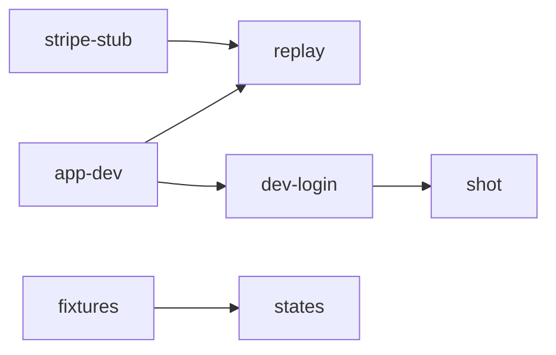
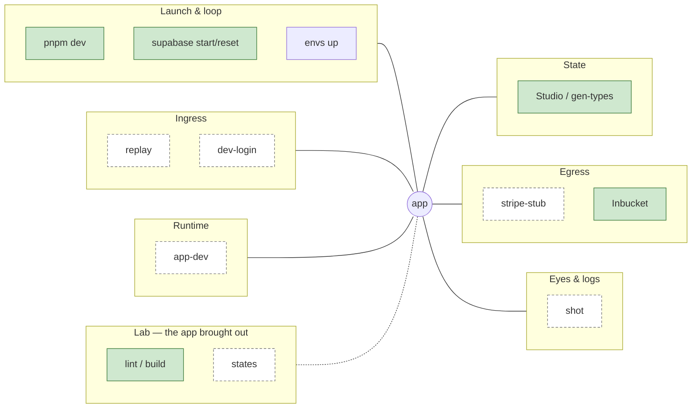

# Agent map — subscription-payments @ bdd0813 (2026-11-24)

## Contents
- Evidence grid
- Parallel agents
- Tools already in place
- Capabilities
- Delivered handles
- Candidate handles (not built)
- Deferred handles
- Roadmap
- Rules → guards
- Fences to set first
- Diagram
- Points
- Classes with no point
- Unknowns
- Decisions
- Revisions
- Accepted plan
- Grill
- Noticed in passing

**Shape(s):** web app, Next.js 14 App Router + Supabase (Postgres, Auth) + Stripe · **Repos covered:** this one (no parent `toolsmith/decisions.md`, no earlier map found) · **Mapped by:** Claude (read-only; nothing was run), grilled with nobody (questions written with recommended answers)

**Task mix:** weak evidence. Only the newest ~22 of the last 50 non-merge commits could be listed (the git command that would count all 50 was not allowed to run), and they come from the starter template's history. Of those 22: about 9 are docs/README, 3 are deps/scripts/onboarding (no level); the behavioural ones are about 4 piece (`components/ui/Pricing/Pricing.tsx`, `app/layout.tsx`, `app/account/page.tsx`), about 4 operation/unit (`utils/supabase/admin.ts`, `utils/helpers.ts`, `schema.sql`, `utils/supabase/queries.ts`), 1 large rewrite touching every level (`a138bf7`, Next 14 + Supabase SSR). Roughly 3 of them change what an operation writes (`schema.sql`, `admin.ts`, the migration). The project has no agent file, no tests and no CI to say more.

**Variants:** one way to run it: local `next dev` against local Supabase (`supabase start`) and Stripe **test mode**. The same code points at live Stripe if `STRIPE_SECRET_KEY_LIVE` is set (Fences ⚠ 1).

**In one paragraph:** An agent can read the code and run `next lint`, `next build` and `tsc`, but it can prove almost nothing about behaviour: there is no test suite, no CI, no seed data (`supabase/seed.sql` is empty), no agent file, and every interesting path (checkout, webhook sync, account page) needs a human with a Stripe account, `stripe listen` and a browser login. The state lives in Postgres and in Stripe, so the primitive is a script runner over the app's own `utils/supabase/admin.ts` plus a local stand-in for Stripe. Three capabilities would change the most: knowing what a Stripe event wrote to the database and failing when it differs; reaching the signed-in account/pricing state as a persona without a human; and seeing each state of the pricing and account screens without Stripe or a login.

## Evidence grid

| Level | Bring out — lab | Witness — effects | Reach in — live |
|---|---|---|---|
| unit — helpers (`utils/helpers.ts`: `getURL`, `toDateTime`, `calculateTrialEndUnixTimestamp`) | gap: no test runner in `package.json`, no test files; pure functions an agent could test | n/a: pure functions write nothing | n/a: nothing to reach below a piece |
| piece — screens (`components/ui/Pricing/Pricing.tsx`, `app/account/page.tsx`, auth forms) | gap: no Storybook or component lab; `Pricing` takes props but nothing renders it without the app | gap: no record of the calls a screen makes (checkout server action, portal link) | gap: a screenshot needs a human sign-in plus Stripe prices synced |
| operation — webhook route, server actions, `admin.ts` upserts | gap: the webhook runs only through a signed POST (`app/api/webhooks/route.ts:33`) and every `admin.ts` path calls the real Stripe API (`utils/supabase/admin.ts:228`) | gap: nothing records what an event wrote; 6 write paths use the service-role client that bypasses RLS (`utils/supabase/admin.ts:15`) | gap: `stripe listen` (`package.json:10`) needs a Stripe login and forwards live test-mode events; no way to send a chosen event offline |
| journey — sign up, sign in, checkout, manage subscription | gap: no e2e suite | gap: the sign-in mail goes to Inbucket (`supabase/config.toml:55`) but nothing reads it for the agent | gap: a human starts two servers, signs up and clicks; checkout ends on Stripe's hosted page, which an agent cannot drive |

## Parallel agents

**Agents that can safely work at once today: 1** — the local Supabase stack has fixed ports and one project, the dev server is on 3000, and Stripe test mode is one shared account.

| Shared resource | Shared by | What collides | Isolation today | Proposal (level 1 · 2 · 3) |
|---|---|---|---|---|
| Supabase local stack (api 54321, db 54322, studio 54323, inbucket 54324: `supabase/config.toml:8,20,49,58`) | every worktree | one database, one `auth.users`; `supabase db reset` wipes everyone's rows | none | level 1: per-agent schema or a second `project_id`/port block via an env flag; level 2: per-env stack |
| dev server port 3000 | every `next dev` | second server fails or moves ports and breaks `site_url` (`supabase/config.toml:72`) | none | port derived from `--env` |
| Stripe test-mode account (customers, products, prices) | every run with a real key | `stripe.customers.create` / `list({email})` (`utils/supabase/admin.ts:108,142`) share one customer per email | none | the local Stripe stand-in removes it for agents |
| `stripe listen` webhook secret (`STRIPE_WEBHOOK_SECRET`) | the one human session | only one forwarder per account is sane | none | agents sign their own events with a local secret |
| `types_db.ts`, `.next/` build output | every worktree | regenerated files | git worktree separates them | none needed |

## Tools already in place

| Tool | Category | Verb | Way | Level | Point(s) | Usage |
|---|---|---|---|---|---|---|
| `pnpm lint` (`next lint`, `package.json:7`) | lab | check | bring out | unit | B4 | `pnpm lint` |
| `next build` / TypeScript compiler | lab | check | bring out | unit | B11 | `pnpm build` |
| `pnpm dev` | launch | see | reach in | journey | B2 | `pnpm dev` (needs `.env.local`) |
| `supabase:*` scripts | state | steer | reach in | operation | B5 | `pnpm supabase:start`, `pnpm supabase:status`, `pnpm supabase:reset` |
| `supabase:generate-types` | state | check | reach in | operation | B5 | `pnpm supabase:generate-types` (types vs live schema) |
| Supabase Studio (local, `:54323`) | state | see | reach in | operation | B5 | browser only; a human path |
| Inbucket (local mail catcher, `:54324`) | egress | see | witness | journey | B6 | HTTP on 54324 (not scripted) |
| `stripe:fixtures` / `stripe:listen` | egress | steer | reach in | operation | B6 | `pnpm stripe:fixtures`, `pnpm stripe:listen` (need Stripe CLI login, network, real test account) |
| `prettier` | lab | check | bring out | no level | B11 | `pnpm prettier-fix` |

Not run here (read-only mandate, no `node_modules` check made): `pnpm`, `tsc`, `supabase` and the Stripe CLI may or may not be installed.

## Capabilities

| # | Capability — the agent can… | Today | Evidence |
|---|---|---|---|
| C1 | know what a Stripe event (product, price, subscription, checkout completion) wrote to the database, and fail when it differs from what it should | a human runs `stripe listen` and trigger commands against a real test account, then reads Studio | operation × lab/witness/reach in gaps; `app/api/webhooks/route.ts:11-22` handles 10 event types; `utils/supabase/admin.ts` is where every write lands; `a4719c4`, `80f6515` changed exactly this |
| C2 | reach the signed-in state as a chosen persona (stranger, subscriber, lapsed subscriber) with a session, unattended | a human signs up in the browser; `supabase/seed.sql` is empty (0 lines); `config.toml` sets `enable_confirmations = false` (line 94), so sign-up works without mail, but no handle uses it | journey × reach in; `utils/auth-helpers/server.ts:166` (`signUp`), `app/account/page.tsx:21` redirects strangers |
| C3 | see every state of the pricing and account screens (no products, monthly/yearly, subscribed, trial, error toast) without Stripe or a login | none; the screens only render through the running app against synced data | piece row; `Pricing.tsx` and `account/page.tsx` are the most-touched UI in the log |

All three sit in operation/piece/journey; the unit row is not a capability here because the only pure logic is three small helpers (`utils/helpers.ts`), cheap to cover with an ordinary test file whenever a task touches them. Launching and resetting (`supabase db reset`, ports) are the loop under these, not capabilities.

## Delivered handles

None yet.

## Candidate handles (not built)

No external tool fits better than project code for the primitive: considered `stripe-mock` (Stripe's own fake API, a Go binary: it answers any call with schema-valid canned data, so it cannot return the subscription an event refers to) and the Stripe CLI `trigger` (needs a login and the network). A small stub in TypeScript serving exactly the 6 Stripe calls the app makes (`customers.create/retrieve/list/update`, `subscriptions.retrieve`, `checkout.sessions.create`, `billingPortal.sessions.create`) is smaller and deterministic.

### `app-dev` — runtime · B3 Runtime · steer, see · reach in at operation · cost S
**Status:** proposed
**Finishes:** **New** (the primitive: state lives in Postgres)

```sh
$ pnpm app-dev run state subscriptions
{"table":"subscriptions","rows":0}
$ pnpm app-dev run reset
{"reset":"ok","users":0,"products":0}
```

**Is:** a `scripts/agent/` entry point (`tsx` as a dev dependency, same `@/` alias as `tsconfig.json`) that loads `.env.local`, refuses non-loopback URLs, and runs a named script from `scripts/agent/*.ts` that imports the app's own `utils/supabase/admin.ts`. Scripts under it are in the table below.
**Gives the agent:** one way to read or set up database state from the command line, using the app's own code and types.
**Not a script because:** it is the primitive the scripts run on.
**Origin:** map — state lives in Postgres and Stripe; no handle exists.
**Fence:** exits unless `NEXT_PUBLIC_SUPABASE_URL` is loopback (`127.0.0.1`/`localhost`) and no `STRIPE_SECRET_KEY_LIVE` is set.
**Parallel:** `--env` selects schema/ports once `envs up` exists; until then 1 agent.
**Permission:** allow (loopback only).

| Script | Usage → prints | Needs |
|---|---|---|
| `state` | `app-dev run state subscriptions` → `{"table":"subscriptions","rows":N}` and a short row listing | service-role key for the local stack |
| `personas` | `app-dev run personas` → creates `stranger`, `subscriber`, `lapsed` through the Supabase auth admin API plus `customers`/`subscriptions` rows; prints their ids | seed data lives here, since `supabase/seed.sql` is empty |
| `writes` | `app-dev run writes before` / `after` → table-by-table row diff: `subscriptions +1 customers +0 users ~1` | snapshot of the 5 tables in `schema.sql` |

### `stripe-stub` — egress · B6 Egress · stub, freeze · bring out at operation · cost M
**Status:** proposed
**Finishes:** **New**

```sh
$ pnpm stripe-stub start --port 12111 --scenario subscribed
stripe-stub listening on 127.0.0.1:12111 · scenario subscribed (1 customer, 1 sub active)
$ curl -s 127.0.0.1:12111/v1/subscriptions/sub_1 | head -c 80
{"id":"sub_1","status":"active","items":{"data":[{"price":{"id":"price_monthly"}}]}…
```

**Is:** a small HTTP server in `scripts/agent/stripe-stub.ts` answering the 6 Stripe API calls listed above from scenario files, plus a one-line change in `utils/stripe/config.ts:3` that passes `host`/`port`/`protocol` to the `Stripe` constructor from `STRIPE_API_HOST` (unset in production = no change). Scenarios are JSON, derived from `fixtures/stripe-fixtures.json`.
**Gives the agent:** the webhook code and the checkout action run with no Stripe account, no network, deterministic ids.
**Not a script because:** it replaces the other side of a boundary and must stay running while the app calls it.
**Origin:** map — `utils/supabase/admin.ts:108,136,142,200,228` and `utils/stripe/server.ts:89,153` all call Stripe synchronously; C1 and C2 cannot run without it.
**Fence:** the config change honours `STRIPE_API_HOST` only when it is loopback; fails closed to the real host if unset.
**Parallel:** port per `--env`; scenarios are per process.
**Permission:** allow.

### `replay` — ingress · B7 Ingress · steer, check · witness at operation · cost S
**Status:** proposed
**Finishes:** the manual `stripe listen` / `stripe trigger` loop (`package.json:10`)

```sh
$ pnpm app-dev run replay customer.subscription.updated --scenario subscribed --expect expected/sub-updated.json
POST /api/webhooks → 200 {"received":true}
wrote: subscriptions ~1 (status active→past_due) · customers 0 · users 0
expected: matches
```

**Is:** a script under `app-dev` that builds the event from the scenario, signs it with `Stripe.webhooks.generateTestHeaderString` and `STRIPE_WEBHOOK_SECRET`, POSTs it to the local server, and runs `writes before/after`; exit 1 when the diff differs from the `--expect` file (the declaration a human reviews in the diff).
**Gives the agent:** a Stripe event in, a database diff out, pass or fail.
**Not a script because:** it is one (a script under `app-dev`); listed as a card only because it is the demo of C1.
**Origin:** map — the webhook route has no test and the C1 evidence above.
**Needs:** `app-dev`, `stripe-stub`, the dev server running.
**Fence:** refuses a non-loopback target and any secret not from `.env.local`.
**Parallel:** `--env`; per-env database.
**Permission:** allow.

### `dev-login` — ingress · B9 Identity · steer · reach in at journey · cost S
**Status:** proposed
**Finishes:** **New**

```sh
$ pnpm app-dev run login --as subscriber
{"user":"subscriber@example.test","cookie":"sb-127-auth-token=base64-…","expires":"2026-11-24T17:00:00Z"}
$ curl -s -b "$(…)" localhost:3000/account | grep -c "Your Plan"
1
```

**Is:** a script under `app-dev` using `supabase.auth.signInWithPassword` for a persona created by `personas`, and writing the session cookie in the format `@supabase/ssr` expects (`utils/supabase/server.ts`).
**Gives the agent:** a signed-in request to any page, no browser, no mail.
**Not a script because:** it is one; kept as a card as the demo of C2.
**Origin:** map — `app/account/page.tsx:21` redirects strangers; `enable_confirmations = false` (`supabase/config.toml:94`) already allows it.
**Needs:** `app-dev`, `personas`.
**Fence:** loopback only.
**Parallel:** sessions per env.
**Permission:** allow.

### `shot` — eyes · B1 Human UI · see · reach in at piece · cost M
**Status:** proposed
**Finishes:** **New**

```sh
$ pnpm app-dev run shot /account --as subscriber
shots/account-subscriber.png (1280×900) · title "Account" · console errors: 0
```

**Is:** a script under `app-dev` driving a headless browser (Playwright; a dev dependency, not present today) with the cookie from `dev-login`; prints the path, the title and console errors.
**Gives the agent:** the rendered page, as a persona, as a file it can open.
**Not a script because:** it is one; the browser runner is the primitive for what lives in the browser.
**Origin:** map — C2/C3: the UI is the only thing checked by eye today.
**Needs:** `app-dev`, `dev-login`, a browser install (network once, at build time).
**Fence:** only loopback hosts.
**Parallel:** port per env; screenshots in a per-run folder.
**Permission:** allow.

### `states` — lab · B4 Internal seams · see, check · bring out at piece · cost M
**Status:** proposed
**Finishes:** **New** (no Storybook exists)

```sh
$ pnpm states list pricing
pricing/no-products       http://127.0.0.1:6006/?path=/story/pricing--no-products
pricing/monthly-yearly    http://127.0.0.1:6006/?path=/story/pricing--monthly-yearly
$ pnpm states check pricing
3 states · 3 render as declared · 0 drift
```

**Is:** a small lab that renders `Pricing` and the account forms with fixture props from `fixtures/` and fails when the real page no longer passes props of the same shape (types come from `types_db.ts`).
**Gives the agent:** every state of the pricing screen in one command, no login, no Stripe.
**Not a script because:** it runs the app's code outside the live app, in a lab.
**Origin:** map — C3; `Pricing.tsx` is the most-changed screen in the log.
**Fence:** no network; fixtures only.
**Parallel:** port per env.
**Permission:** allow.

Unranked: no priorities were given.

## Deferred handles

### `envs up` — launch · B2 Process · steer · loop · cost M
**Status:** deferred
**Deferred because:** one agent at a time is enough for the first milestones; the stack ports are fixed in `supabase/config.toml`.
**Revisit when:** a second agent works in parallel.

```sh
$ pnpm envs up a1
a1: next :3101 · supabase api :54421 db :54422 · stripe-stub :12112
```

## Roadmap

**Foundations**

| Foundation | Used by | Unlocks | Cost |
|---|---|---|---|
| `app-dev` (primitive; state lives in Postgres) | `replay`, `dev-login`, `shot`, scripts `state`, `personas`, `writes` | every script after | S |
| `stripe-stub` + the `STRIPE_API_HOST` line in `utils/stripe/config.ts` | `replay`, checkout/portal paths of `dev-login`/`shot` | no Stripe account | M |



### M1 — what a Stripe event wrote · keystone
**Capability:** C1 — know what a Stripe event wrote and fail when it differs.
**Status:** proposed
**Builds:** `app-dev` (scripts `state`, `writes`), `stripe-stub`, `replay`.
**Depends on:** none (needs `pnpm supabase:start` and `pnpm dev` running by hand).
**Demo:** `pnpm stripe-stub start --scenario subscribed & pnpm app-dev run replay customer.subscription.updated --scenario subscribed --expect expected/sub-updated.json`
**Expect:** `POST /api/webhooks → 200`, `subscriptions ~1 (status active→past_due)`, `expected: matches`, exit 0; editing the expectation file makes it exit 1.
**Why first:** the webhook and `admin.ts` hold all the business logic and every schema/write change in the log; nothing checks it today.

### M2 — reach the signed-in state
**Capability:** C2 — reach any persona's session unattended.
**Status:** proposed
**Builds:** script `personas`, `dev-login`, `shot`.
**Depends on:** M1 — `app-dev`, `stripe-stub`.
**Demo:** `pnpm app-dev run personas && pnpm app-dev run shot /account --as subscriber`
**Expect:** `shots/account-subscriber.png` shows the plan and manage-subscription button; `--as stranger` is redirected to `/signin`.

### M3 — every state of a screen
**Capability:** C3 — see every state of pricing and account without Stripe or login.
**Status:** proposed
**Builds:** `states`.
**Depends on:** none.
**Demo:** `pnpm states list pricing && pnpm states check pricing`
**Expect:** the addresses printed; `check` reports 0 drift and fails when props change shape.

### Deferred

- `envs up` — see Deferred handles.

## Rules → guards

No agent file exists (no `CLAUDE.md`, `AGENTS.md`), so there are no prose rules to turn into guards. Suggested first guards, which a new agent file would hold: a hook blocking `supabase db reset` against a linked remote and `supabase db push`/`link` (`package.json:17,21`), and a hook refusing commands when `STRIPE_SECRET_KEY_LIVE` is set.

| Rule (where) | Guard | Kind |
|---|---|---|
| none written | block `pnpm supabase:push`, `supabase:link`, `stripe:fixtures` unless a loopback/test env is confirmed | hook |

## Fences to set first

| ⚠ | Fence | Evidence | Why it matters to an agent |
|---|---|---|---|
| 1 | live Stripe key takes precedence over the test key | `utils/stripe/config.ts:4` (`STRIPE_SECRET_KEY_LIVE ?? STRIPE_SECRET_KEY`); `utils/stripe/client.ts:8` | a stray live key in the environment makes any local run create real customers and checkout sessions |
| 2 | `stripe:fixtures` and `stripe listen` write to the account the CLI is logged into | `package.json:10-11`, README | an agent running them can create products in a real account; they run only after the CLI is confirmed to be in test mode |
| 3 | `supabase:push`, `supabase:link`, `supabase:pull` touch a remote project | `package.json:17,21,22` | no guard says "local only" |
| 4 | service-role client bypasses RLS | `utils/supabase/admin.ts:13-18`, key class `SUPABASE_SERVICE_ROLE_KEY → unset` in `.env.local.example` | agent scripts importing it must be pinned to a loopback URL first |

Env classes (names only; the repo ships only `.env.example` and `.env.local.example`, no real `.env.local` was read): `NEXT_PUBLIC_SUPABASE_URL → unset`, `STRIPE_SECRET_KEY → unset`, `STRIPE_WEBHOOK_SECRET → unset`.

## Diagram



## Points

- **B1 Human UI** — 7 pages/routes (`find app -name page.tsx`: account, signin, signin/[id], home) and `components/ui/*` · see human · steer human · existing none.
- **B2 Process** — `package.json:4-22` scripts; ports 3000 and 54321-54324 · see ✓ `supabase:status` · steer ✓ scripts · stub ✗.
- **B3 Runtime** — Next dev server (`next dev --turbo`, `package.json:4`); no debugger port or eval handle · ✗.
- **B4 Internal seams** — server actions `utils/auth-helpers/server.ts`, `utils/stripe/server.ts` (`'use server'`, line 1); data layer `utils/supabase/{admin,queries}.ts` · `Pricing` takes props (a lab seam) · existing none.
- **B5 State stores** — Postgres tables `users, customers, products, prices, subscriptions` (`supabase/migrations/20230530034630_init.sql`; RLS at lines 15,44,65,98,137); auth sessions via cookies (`utils/supabase/middleware.ts`) · see ~ Studio, human · steer ✗ (empty `supabase/seed.sql`).
- **B6 Egress** — Stripe API (`utils/supabase/admin.ts:108,136,142,200,228`, `utils/stripe/server.ts:89,153`) · stub ✗ (no host override); auth mail → Inbucket (`supabase/config.toml:55`) · see ~ human.
- **B7 Ingress** — `POST /api/webhooks` (`app/api/webhooks/route.ts:24`), `GET /auth/callback`, `GET /auth/reset_password` (`app/auth/*/route.ts`); server actions · steer ~ `stripe listen` · check ✗.
- **B8 Time & chance** — 2 `new Date()` reads: `utils/helpers.ts:64` (trial end), `components/ui/Footer/Footer.tsx:96`; `toDateTime` converts Stripe seconds · freeze ✗ (small).
- **B9 Identity** — Supabase Auth password/OTP/OAuth (`utils/auth-helpers/server.ts:35,134,166`, `client.ts:29`), middleware refresh (`middleware.ts:4`) · steer ✗.
- **B10 Platform** — none.
- **B11 Delivery** — `next build`; Vercel deploy button in README; no CI · check ✓ `pnpm build`.
- **B12 Telemetry** — `console.log` in the webhook and `admin.ts` (e.g. `app/api/webhooks/route.ts:34`) · see ~ the dev server's stdout only.
- **B13 Configuration** — env-selected Stripe key (`utils/stripe/config.ts:4`, live wins), site URL (`utils/helpers.ts:7-16`), `TRIAL_PERIOD_DAYS = 0` (`utils/supabase/admin.ts:11`), Supabase auth settings (`supabase/config.toml:72-105`).

## Classes with no point
- B10 Platform — none found (looked at: device APIs, file pickers, workers; nothing outside the browser and OS ports).

## Unknowns
- Whether `pnpm`, `supabase` and `stripe` are installed here and whether `node_modules` exists: not checked (read-only; no toolchain probing). → owner: the first build step.
- The exact commit mix over 50 commits: only ~22 could be listed. → rerun `git log --no-merges -50` once allowed.
- Whether anyone deploys from this repo or it is a template only (no CI, no agent file, README is a deploy guide): affects how much the roadmap is worth.

## Decisions

None recorded (no `toolsmith/decisions.md` in the project or its parent folder).

## Revisions

None.

## Accepted plan

Not accepted yet; nobody was available to review. Status of every card and milestone: `proposed`.

## Grill

Nobody was available; the questions and my recommended answers:

1. **Is this a template you deploy, or a product you keep changing?** Recommended: treat it as a product base that gets a few edits to `admin.ts`, the webhook and pricing UI; build M1 only, because the webhook sync is where behaviour lives.
2. **May the `STRIPE_API_HOST` override line be added to `utils/stripe/config.ts`?** Recommended: yes, loopback-only and unset by default; without it `stripe-stub` cannot work and M1 falls back to a real Stripe test account.
3. **Which personas matter?** Recommended: `stranger`, `subscriber` (active monthly), `lapsed` (past_due), because the account page branches on subscription status.

## Noticed in passing

`utils/stripe/config.ts:4` lets a live key silently win over the test key, and `app/api/webhooks/route.ts:79` throws in a branch that cannot be reached for the relevant event set; the first matters to agents (Fences ⚠ 1), neither is the map's job.
