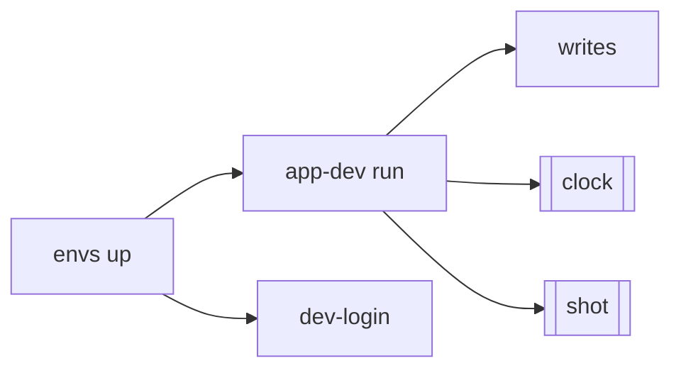
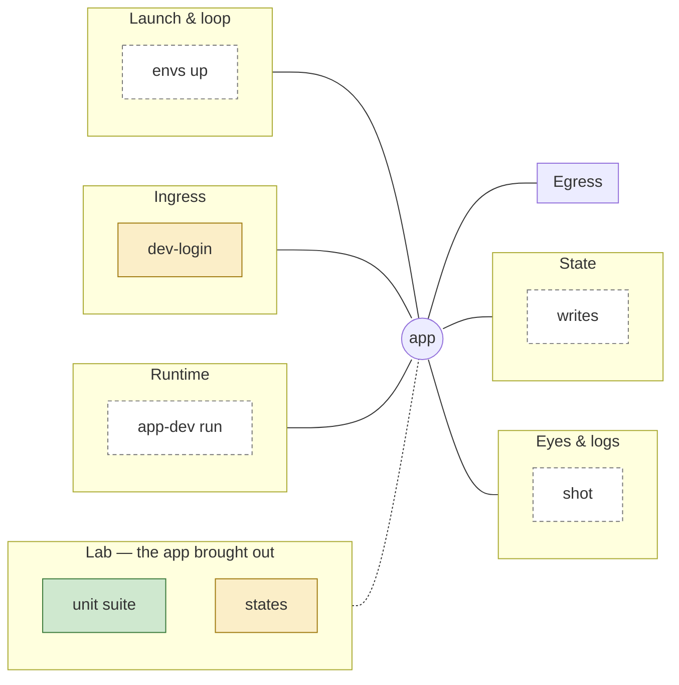

# Agent map — <project> @ <commit> (<date>)

## Contents
- Evidence grid
- Parallel agents
- Tools already in place
- Capabilities
- Delivered handles
- Candidate handles (not built)
- Deferred handles
- Roadmap
- Transferable patterns
- Rules → guards
- Fences to set first
- Diagram
- Points
- Classes with no point
- Unknowns
- Decisions
- Revisions
- Accepted plan
- Grill
- Noticed in passing

**Shape(s):** <…> · **Repos covered:** <…> · **Mapped by:** <agent>, grilled with <who>

**Task mix:** 50 commits — 38 behavioural: 18 piece (screens), 12 operation (routes, SQL functions), 6 unit, 2 journey; 12 no level (dependency bumps, docs, CI); 11 change what an operation writes.

<One line: the last ~50 non-merge commits by the level they change (map.md, step 0b), the ones that
change no behaviour counted apart, and how many change what an operation writes or sends. It
decides what comes first.>

**Variants:** <the ways this app runs that support different handles — e.g. the shipped runtime vs
a local build of it, two render backends, debug vs release; one line each, and which handles
exist only on one of them. Omit when there is one way to run it.>

**In one paragraph:** how well an agent can reach this app today, and the two or three capabilities that would change that most.

## Evidence grid

What an agent can prove at each level, by each way (grid.md). Rows in the shape's words
(shapes.md, "Levels by shape"); every cell starts with its verdict — `gated:` · `asserted:` ·
`observed:` (filled, with the command) · `gap:` (what a task loses) · `n/a:` (why). A lab with no tie
to the live app is `observed` at most. After the verdict, every cell is **decided** — `→ propose` ·
`→ leave` · `→ either`, with why (grid.md, "Then decide each cell"): each propose cell gets a card or
a deferral, no card lands in a leave cell. The review page draws this table with each card in its cell
and flags a decision the cards contradict.

| Level | Bring out — lab | Witness — effects | Reach in — live |
|---|---|---|---|
| unit — functions, SQL functions | asserted: `bun test` (412 tests, 38 s, in CI); `supabase test db` (rolled-back SQL tests) → leave: they reach every function and SQL function that changes | asserted: the SQL tests select the rows they inserted → leave: covered | n/a: nothing to reach below a piece → leave |
| piece — screens and regions; server actions | observed: 12 Storybook stories, nothing ties them to the page (`.storybook/main.ts:3`); gap: no server action can be tested — each builds its own client (`lib/db/server.ts:12`) → propose: 18 + 12 of 38 behavioural commits land here | gap: no record of the calls a screen makes → either: no task in the mix needed it | gap: a screenshot needs a human login → either: the lab shows the states without one |
| operation — routes, server actions, SQL functions | gap: an operation runs only through the whole app → either: the piece harness and `writes` cover what the mix changes | gap: nothing records what an operation wrote; 9 routes use the service-role client (`lib/db/admin.ts:4`) → propose: 11 commits change writes, RLS bypassed | observed: `curl` on the dev server with a cookie copied by hand → either |
| journey — a session as a persona | gap: no e2e suite → either: 2 journey commits in 38 | gap: mail goes through the live provider (Fences ⚠ 1) → either: the fence comes first | gap: a human starts the server and logs in → propose: every bug report starts here |

## Parallel agents

**Agents that can safely work at once today: <n>** — <one line: what stops the next one>.

| Shared resource | Shared by | What collides | Isolation today | Proposal (level 1 · 2 · 3) |
|---|---|---|---|---|
| Postgres `app_dev` | every worktree | seed rows; the `app_settings` clock row (global) | none | level 1: schema per env; the clock row becomes per-env |
| port 3000 | every dev server | the second server fails to start | none | level 2: port derived from `--env` |

## Tools already in place

Every handle an agent could already call **before toolsmith built anything** — test suites
included — with its category for the diagram (launch · ingress · runtime · state · egress · eyes ·
lab) and its level. A tool that climbs several ways gets one row per verb. A handle toolsmith
builds is not added here: its card moves to Delivered handles.

| Tool | Category | Verb | Way | Level | Point(s) | Usage |
|---|---|---|---|---|---|---|
| unit suite | lab | check | bring out | unit | B4 | `bun test --filter checkout` |
| SQL tests | lab | check | bring out | unit | B5 | `supabase test db` |
| Storybook | lab | see | bring out | piece | B4 | `bun run storybook` |

## Capabilities

The backbone of the roadmap: what the agent **cannot do today** on this project, named before any
card. Two to five, each a thing the agent can do once it is delivered — "reach any screen as any
persona, unattended" — never a tool or a handle name ("Playwright", "`dev-login`"). Each rests on
evidence from the survey: a point, a task that needed it, a human step in an agent file. Handles
are the means; every card serves a capability through the milestone that builds it, and a card no
capability needs is not proposed.

| # | Capability — the agent can… | Today | Evidence |
|---|---|---|---|
| C1 | see every state of a screen, and know the page still renders it, without launching | a human logs in and clicks to the state; the stories drift | piece row of the grid; 18 of 38 behavioural commits change screens |
| C2 | know what an operation wrote, and fail when it differs from what it should | nothing records it; a wrong write is found in production | operation × witness; 11 of 38 behavioural commits change writes; 9 service-role routes |
| C3 | reach any state as any persona, at any time | ad-hoc seeds; login typed by the human | journey × reach in; `db/seeds.sql` personas, no session mint; 35 `new Date()` reads (B8) |
| C4 | test one server action in a second, with no stack | the 412 unit tests reach no server action: each builds its own client | piece × bring out; `lib/db/server.ts:12`; 12 of 38 behavioural commits change server actions |

**Today** says what happens instead: a human step, an ad-hoc script, or nothing. Each capability
is delivered by one or more milestones, or listed under the roadmap's Deferred with why. Their
cells differ because this project's task mix does: on a project whose commits are mostly
journeys, C1 would be the launch-and-login loop. Capabilities that all sit in one cell need a
sentence saying why the other cells do not matter here. Launching, isolating and resetting are
never a capability: `envs up` is the foundation M2 builds, not a milestone of its own.

## Delivered handles

Cards toolsmith built, moved here from Candidate handles when they were delivered — never left
under the candidates, where they would read as proposed work. Same card grammar, with
**Status:** `delivered` and a mandatory **Verified:** line (see "Status and evidence" below). Empty
until the first build.

## Candidate handles (not built)

The map's main output. Group by way; finish what the project half-has before inventing. If no
external tool fits, say so in one line ("no tool fits: considered Storybook, motu — Vue 2").
**Card heading grammar** — the review page reads it, so keep it exact:
`### \`<name>\` — <category>[ (+ <category>…)] · <B-class> <name> · <verbs> · <way> at <level> · cost <S|M|L>`
(categories: launch, ingress, runtime, state, egress, eyes, lab; ways: reach in, bring out,
witness; levels: unit, piece, operation, journey — the cell the card fills). A card that only
launches or isolates has no cell of its own: write `loop` for its way and level. Group headings
without that shape (`### Reach in`) are allowed and ignored.

**Scripts under a primitive** go in its card as a table the review page reads:

| Script | Usage → prints | Needs |
|---|---|---|
| `press` | `run press Enter 3` → `{"pressed":"Enter","frames":3}` | an input-injection API in the engine |

A card may add a **Variants:** line when it exists only on some of the ways the app runs. A
handle that is pure configuration (env vars, a flag on an existing command) is still a card: its
**Is:** says so ("an env preset for the existing auth-proxy"), and its usage block shows it in use.
An **existing** handle that is itself a hazard (a debug port open in release) is listed in Tools in
place *and* gets a card to finish it — its missing fence is the work.

**Status and evidence.** Every card carries a **Status:** line, and the section matches it:

| Status | Section | Means |
|---|---|---|
| `proposed` | Candidate handles | on the map, not yet accepted |
| `accepted` | Candidate handles | in the accepted plan (dated), not started |
| `in progress` | Candidate handles | being built; say what is done |
| `delivered` | Delivered handles | built and merged; **Verified:** required |
| `deferred` | Deferred handles | not now; **Deferred because:** required |

**Verified:** `<level> — <evidence>` — keep the three levels apart, never round one up:
`implemented` (the code exists, nothing was run) · `tested` (focused tests or the usage example
ran: which, and what it printed) · `demoed` (it ran end to end against the live app: the command
and the date). A caveat follows a `;`: `tested — 4 unit tests pass; live demo deferred: no display
on the CI box`.

Three lines are mandatory on every card besides the usage block. **Is:** what you would actually
build and where — a new CLI in `tools/`, a public API in the engine plus its binding, an env flag
read by the backend, a file in `scripts/agent/`. **Not a script because:** for any card that is not
a script under a primitive, which of the exemptions applies (principles.md); no exemption, no card — it becomes a script line under the primitive. A handle owned by
a **lower layer** (the engine under a game, the runtime under an app) is not a card in this map: list
it as **Uses:** `<handle>` (from `<that layer>`'s map — or "to propose in `<that layer>`" when it has
no map yet) on the cards that depend on it. And a
**Parallel:** line: how the handle isolates two agents running it at once, or why it cannot; a
**Permission:** line: allow · ask · deny in the agent's harness. Size the usage output for an
agent: what the command prints by default, short.

One card per handle — the usage block is mandatory, and it is what makes it a handle: if the
agent never calls it (an untracked file, a default, a lint rule, a CI step), it is not a card —
it is a Fence or Needs line of the handle it serves, or one of the Fences to set first.

### `states` — lab · B4 Internal seams · see, check · bring out at piece · cost M
**Status:** accepted (2026-11-18, M1)
**Finishes:** the 12 Storybook stories (`src/**/*.stories.tsx`)

```sh
$ bun run states list checkout
checkout/empty         http://127.0.0.1:6006/?path=/story/checkout--empty
checkout/three-items   http://127.0.0.1:6006/?path=/story/checkout--three-items
$ bun run states check checkout
2 states · 2 render in the placed page as declared · 0 drift
```

**Is:** a CLI over the existing Storybook: lists each story as an address, and a tie to the live
app — mounts the page route with each story's args and fails when the page no longer renders it.
**Gives the agent:** every state of a screen in one command, no login, and a lab that cannot drift.
**Not a script because:** it runs the app's code outside the live app, in a lab.
**Considered:** motu *(by the skill's author)* — fits (React 18, Vite, screens sharing a store),
but twelve stories already exist; finishing them costs less. Revisit if screens keep sharing state.
**Origin:** map — 18 of 38 behavioural commits change screens.
**Fence:** fixtures from `tests/fixtures/`, typed against the app's types; no network.
**Parallel:** port derived from `--env`; no shared state.
**Permission:** allow.

### `writes` — state (+ egress) · B5 State stores · see, check · witness at operation · cost M
**Status:** proposed
**Finishes:** **New**

```sh
$ app-dev run writes POST /api/orders --as member --fixture order-3-items
POST /api/orders as member: wrote orders(1) order_items(3) · called reserve_stock() · rls on
declared: orders, order_items · undeclared: none
```

**Is:** statement logging on the local Postgres, attributed by request id, and `.agent/writes.json`
declaring what each route may write; exit 1 on an undeclared write. The declaration's diff is
what the human reviews.
**Gives the agent:** what one operation wrote, read and bypassed, and a check that fails when that changes.
**Not a script because:** out-of-band by nature — an effect ledger.
**Origin:** map — 11 of 38 behavioural commits change what an operation writes; 9 routes bypass RLS.
**Needs:** `app-dev run`; the request id set on the connection (`set_config('app.request_id', …)`).
**Fence:** refuses a non-loopback database URL; records table names and counts, never values.
**Parallel:** per-env database (`envs up`).
**Permission:** allow.

### `test:piece` — lab · B4 Internal seams · steer, check · bring out at piece · cost M
**Status:** proposed
**Finishes:** the unit suite (`bun test`, 412 tests), which reaches no server action

```sh
$ bun run test:piece orders/create
orders/create · fake store · 4 tests · 4 pass · 0.8 s
```

**Is:** an in-memory store behind the `Db` port, and a runner that executes one server action's
tests against it — a harness, not tests: the tests come with each task.
**Gives the agent:** a verdict on one server action in a second, with no stack and no login.
**Not a script because:** it runs the app's code outside the live app, in a harness.
**Origin:** map — 12 of 38 behavioural commits change server actions; none of them can be tested today.
**Needs:** server actions take their client as an argument instead of building it (`lib/db/server.ts:12`).
**Fence:** the fake stays true — a contract test runs the same fixtures through `writes` on the local Postgres and compares the tables written.
**Parallel:** in-process; nothing shared.
**Permission:** allow.

### `dev-login` — ingress · B9 Identity · steer · reach in at journey · cost S
**Status:** proposed
**Finishes:** the seeded personas in `db/seeds.sql` (or **New**)

```sh
$ bin/dev-login --as stranger
{"user":"stranger","cookie":"sb-access-token=…","expires":"2026-11-18T10:00:00Z"}
```

**Is:** a new CLI, `bin/dev-login`, over the auth provider's local admin API — not app code.
**Gives the agent:** any persona's session in one command, no password typed.
**Not a script because:** it must cross the real auth boundary to be faithful.
**Origin:** map (or `task "<…>"`, `want "<…>"` — and `Seen in:` the tasks that needed it).
**Needs:** two seeded personas (`stranger`, `admin`) in `db/seeds.sql`. (A Needs line may name another card: `Needs: envs up`.)
**Fence:** refuses unless the auth URL is loopback.
**Parallel:** `--env` (default: the worktree's) selects the stack; sessions are per env.
**Permission:** allow (read-only against the agent's own env).

Unranked unless a task or the human's priorities were given: <priorities, if any>.

## Deferred handles

Cards kept but not planned, out of the candidates so they never look like open work. Same card
grammar, with **Status:** `deferred` and two more lines:

### `profile` — runtime · B3 Runtime · see · reach in at operation · cost M
**Status:** deferred
**Deferred because:** no commit in the task mix is about speed.
**Revisit when:** a performance task arrives.

```sh
$ app-dev run profile GET /dashboard --as admin
1 240 ms · 38 queries · slowest: dashboard_stats() 910 ms
```

## Roadmap

**Foundations** — bases several cards build on; built once, first.

| Foundation | Used by | Unlocks | Cost |
|---|---|---|---|
| `app-dev run` (the primitive — state lives in Postgres) | `writes`, scripts `clock`, `state`, `shot` | every script after | S |
| per-run environment (`envs up`) | `writes`, `dev-login`, `shot` | parallel agents; no writes in the human's tree | S |



**Milestones are cut by capability.** Each milestone delivers one capability (or a deeper step
of one), named first; its demo proves the capability, not just that the handles run. The cards
it builds are the means.

Every milestone has the same lines, one per line; the review page reads them:

- **Capability:** `C<n>` — the capability it delivers, from the table above.
- **Status:** `proposed` · `accepted` · `in progress` · `delivered`.
- **Builds:** the cards, by their exact names in backticks, and the scripts it adds.
- **Depends on:** the milestones it really needs, each with what it needs from it — or `none`.
  Numbering is the suggested order, **not** a dependency: two tracks that do not need each other
  both say `none` (or name only what they share), and the page shows them as independent.
- **Demo:** the command the agent runs once the milestone is built. **Expect:** what it observes
  when the demo works — the output, the screenshot, the row — concrete enough to fail.
- **Verified:** once anything is built, with the levels of the cards (`implemented` · `tested` ·
  `demoed`) and the caveats. A milestone is `delivered` and demoed only when its **Demo** ran end
  to end; if it did not, say so — `tested — focused tests pass; live demo deferred: <why>` — and the
  page shows it as not demoed.

### M1 — every state of a screen · keystone
**Capability:** C1 — see every state of a screen without launching.
**Status:** accepted (2026-11-18)
**Builds:** `states`.
**Depends on:** none.
**Demo:** `bun run states list checkout && bun run states check checkout`
**Expect:** two addresses printed; `check` reports 2 states rendered as declared, 0 drift — and fails when a story's args no longer match the page.
**Why first:** the most frequent task class (18 of 38 behavioural commits), and it needs no launch, no login.

### M2 — what an operation wrote
**Capability:** C2 — know what an operation wrote, and fail when it differs.
**Status:** proposed
**Builds:** per-run environment, `app-dev run`, `writes`.
**Depends on:** none.
**Demo:** `envs up a1 && app-dev --env a1 run writes POST /api/orders --as member --fixture order-3-items`
**Expect:** `wrote orders(1) order_items(3)`, `undeclared: none`, exit 0; removing `order_items` from the declaration makes it exit 1.

### M3 — reach any state
**Capability:** C3 — reach any state as any persona, at any time.
**Status:** proposed
**Builds:** `dev-login`, scripts `clock`, `shot`.
**Depends on:** M2 — `envs up` and `app-dev run`.
**Demo:** `bin/dev-login --as stranger && app-dev run clock +47h && app-dev run shot reminders`
**Expect:** `shots/reminders.png` shows the 48-hour reminder banner for the stranger.

### M4 — test one server action
**Capability:** C4 — test one server action in a second, with no stack.
**Status:** proposed
**Builds:** `test:piece`.
**Depends on:** M2 — its contract test reuses `writes`.
**Demo:** `bun run test:piece orders/create`
**Expect:** 4 tests pass in about a second with no stack running; breaking the insert of `order_items` in the action makes one fail.

### Deferred

One line per deferred capability, milestone or card, by name, with why; the cards themselves are
under Deferred handles.

- `profile` — no commit in the task mix is about speed.

## Transferable patterns

Optional, at most three: an idea from this project that another project could reuse. Describe the
**capability**, not the tool: what it does, the evidence it matters here, what a project needs
before it fits, and where it does not. Write it in terms another stack could implement — this
project's framework, file names and team conventions stay in the Evidence column. A pattern that
an existing or proposed handle already embodies names that handle or capability in **Here as**;
it is never a second card. These patterns look outward; they do not set this project's roadmap —
the Capabilities do.

| Pattern | Does | Evidence here | Fits when | Does not fit when | Here as |
|---|---|---|---|---|---|
| test-impact selection | runs only the tests a change can reach | `bin/test --changed` cut the suite from 9 min to 40 s (`bin/test:12`) | a dependency graph from code to tests is cheap to compute | tests share global fixtures, or the graph is dynamic (plugins, reflection) | `test` handle, `--changed` |

## Rules → guards

Rules the agent files state in prose, and the guard each could become.

| Rule (where) | Guard | Kind |
|---|---|---|
| "NEVER run `supabase db reset`" (`CLAUDE.md:7`) | pre-tool hook blocking the command, with the reason | hook |
| "use the service layer for DB access" (`CLAUDE.md:9`) | lint rule on imports of the client outside `services/` | lint |

## Fences to set first

At most five, one line each: what an agent's probes or handles here could trigger with real
consequences, and the fence that makes the handles above safe to use.

| ⚠ | Fence | Evidence | Why it matters to an agent |
|---|---|---|---|
| 1 | mail driver falls back to live | `lib/mail.ts:26`, `RESEND_API_KEY → live` | a local serve would email real people — make it fail closed before any handle uses mail |

## Diagram

The app in the middle, the six categories around it and the Lab — the app brought out — framing them, one node per handle: **solid** = exists
(in place before, or delivered), **amber** = half-built (a card that *Finishes* something),
**dashed** = missing (a card marked New). Deferred cards are left out of the diagram. One node per
handle, not per row: a tool listed once per verb is one node, and a tool a card *Finishes* is
drawn only as that card. This is the picture the human reads first — keep node labels to the handle's name.



A category with no handle at all is still drawn, empty — that gap is the finding.

## Points

The survey behind the picture: one line per point, grouped by boundary class. Keep it compact —
the cards above carry the detail.

- **B6 Egress** — mail provider · `lib/mail.ts:42` · see ✓ preview table · stub ~ falls back to live · existing: preview driver (fails closed ✗)

Verb values: `✓ <how>` · `~ <friction>` · `human` · `✗` missing; add `(seen)` or `(docs)` where it
applies. Cross-referenced points: `→ B7`.

## Classes with no point
- B10 Platform — none found (looked at: …)

## Unknowns
- <point>: <what could not be determined> → asked <who> / owner

## Decisions

What the human decided while reviewing this map (grill answers, remarks), dated — applied below.

## Revisions

One entry per revision: what changed, and which remark caused it.

## Accepted plan

Filled only after an explicit go: the handles to build, in order, with the decisions they rest on.
Set **Status:** `accepted` on those cards and milestones at the same time.

## Grill

At most three, each one changing which handle gets built; each with your recommended answer.

## Noticed in passing

One line, optional: security issues in the app itself that are not about the agent's loop
(not the map's job — say where you saw them and move on).

