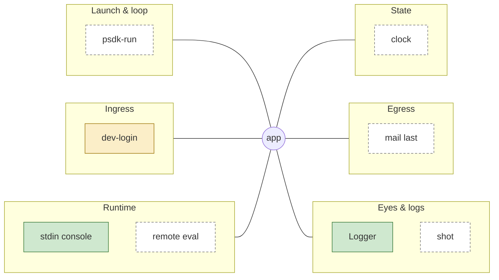

# Agent map — <project> @ <commit> (<date>)

**Shape(s):** <…> · **Repos covered:** <…> · **Mapped by:** <agent>, grilled with <who>

**In one paragraph:** how well an agent can reach this app today, and the two or three handles that would change that most.

## Tools already in place

Every handle an agent can already call, with its category (launch · ingress · runtime · state ·
egress · eyes). A tool that climbs several ways gets one row per verb.

| Tool | Category | Verb | Way up | Point(s) | Usage |
|---|---|---|---|---|---|
| <effect ledger> | egress | check | witness | B5, B6 | `bun run assay:check run.log --require <op>` |
| <stdin console> | runtime | steer, see | reach in | B3 | type a Ruby line in the game's terminal |

## Candidate handles (not built)

The map's main output. Group by way up; finish what the project half-has before inventing. If no
external tool fits, say so in one line ("no tool fits: considered Storybook, motu — Vue 2").
One card per handle — the usage block is mandatory, and it is what makes it a handle: if the
agent never calls it (an untracked file, a default, a lint rule, a CI step), it is not a card —
it is a Fence or Needs line of the handle it serves, or one of the Fences to set first.

### `dev-login` — ingress · B9 Identity · steer · reach in · cost S
**Finishes:** the seeded personas in `db/seeds.rb` (or **New**)

```sh
$ bin/dev-login --as stranger
{"user":"stranger","cookie":"_app_session=…","expires":"2026-11-18T10:00:00Z"}
```

**Gives the agent:** any persona's session in one command, no password typed.
**Needs:** two seeded personas (`stranger`, `admin`) in `db/seeds.rb`. (A Needs line may name another card: `Needs: dev-up`.)
**Fence:** refuses unless `RAILS_ENV=development` and the server binds `127.0.0.1`.

### `remote eval` — runtime · B3 Runtime · steer, see · reach in · cost M
**Finishes:** **New** (remote debug already possible: `debug` gem in the Gemfile)

```sh
$ printf 'dev-token\nUser.count\n' | nc 127.0.0.1 7778
rubyvm-eval/1 token?
OK
=> 1342
```

**Gives the agent:** live state of the running server without pausing it.
**Fence:** development only, loopback, token required.

Unranked unless a task or the human's priorities were given: <priorities, if any>.

## Fences to set first

At most five, one line each: what an agent's probes or handles here could trigger with real
consequences, and the fence that makes the handles above safe to use.

| ⚠ | Fence | Evidence | Why it matters to an agent |
|---|---|---|---|
| 1 | mail driver falls back to live | `lib/mail.ts:26`, `RESEND_API_KEY → live` | a local serve would email real people — make it fail closed before any handle uses mail |

## Diagram

The app in the middle, the six categories around it, one node per handle: **solid** = exists,
**amber** = half-built (a card that *Finishes* something), **dashed** = missing (a card marked
New). This is the picture the human reads first — keep node labels to the handle's name.



A category with no handle at all is still drawn, empty — that gap is the finding.

## Points

The survey behind the picture: one line per point, grouped by boundary class. Keep it compact —
the cards above carry the detail.

- **B6 Egress** — mail provider · `lib/mail.ts:42` · see ✓ preview table · stub ~ falls back to live · existing: preview driver (fails closed ✗)

Verb values: `✓ <how>` · `~ <friction>` · `human` · `✗` missing; add `(seen)` or `(docs)` where it
applies. Cross-referenced points: `→ B7`.

## Classes with no point
- B10 Platform — none found (looked at: …)

## Unknowns
- <point>: <what could not be determined> → asked <who> / owner

## Grill

Questions in order, each with your recommended answer (asked one at a time when a human is there).

## Noticed in passing

One line, optional: security issues in the app itself that are not about the agent's loop
(not the map's job — say where you saw them and move on).

