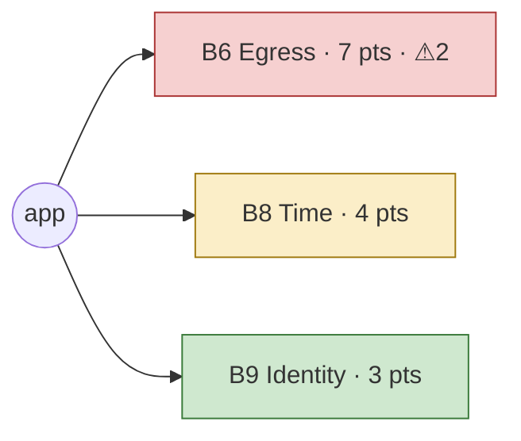

# Agent map — <project> @ <commit> (<date>)

**Shape(s):** <…> · **Repos covered:** <…> · **Mapped by:** <agent>, grilled with <who>

## Safety findings

Every ⚠ point, first, with evidence — before anything else is read.

| ⚠ | Point | Evidence | Why it matters | Suggested fence |
|---|---|---|---|---|
| 1 | mail driver falls back to live | `lib/mail.ts:26`, `RESEND_API_KEY → live` | local runs can email real people | preview by default, refuse to start with a live key |

## Diagram

**One node per boundary class**, coloured by its *worst* point, labelled with its point count
and ⚠ count. Per-point detail lives in the table. Draw per-point nodes only for classes with
≤ 4 points; past ~20 nodes a diagram stops being read.

Legend: green = every point has agent handles meeting the criteria · amber = friction or a
failed criterion · red = some point is human-only · grey dashed = some point has no handle.

## Points

| Class | Point | Evidence | See | Steer | Stub | Freeze | Check | Loop | Existing handle | Fails criterion | ⚠ |
|---|---|---|---|---|---|---|---|---|---|---|---|
| B6 Egress | mail provider | `lib/mail.ts:42` | ✓ preview table | – | ~ falls back to live | – | ✗ | ✓ per-run table | preview driver | 1 (fails closed) | ⚠1 |

Cell values: `✓ <how>` · `~ <friction>` · `human` · `✗` missing · `n/a`. Cross-referenced points:
`→ B7` in the Point cell.

## Tools already in place

| Tool | Verb | Way up | Point(s) |
|---|---|---|---|
| <effect ledger> | check | witness | B5, B6 |
| <effect ledger> | stub (replay) | bring out | B6 |

## Classes with no point
- B10 Platform — none found (looked at: …)

## Unknowns
- <point>: <what could not be determined> → asked <who> / owner

## Candidate handles (not built)

| Boundary · point | Verb | Way up | Handle | Loop / fence notes | Rough cost |
|---|---|---|---|---|---|
| B6 · mail provider | stub, check | witness | catcher with API; refuse to start with a live key | per-run inbox; fails closed | S |

Unranked unless a task or the human's priorities were given: <priorities, if any>.
