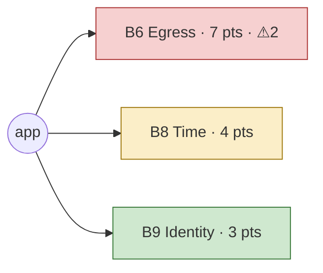

# Agent map — <project> @ <commit> (<date>)

**Shape(s):** <…> · **Repos covered:** <…> · **Mapped by:** <agent>, grilled with <who>

**In one paragraph:** how well an agent can reach this app today, and the two or three handles that would change that most.

## Tools already in place

| Tool | Verb | Way up | Point(s) |
|---|---|---|---|
| <effect ledger> | check | witness | B5, B6 |
| <effect ledger> | stub (replay) | bring out | B6 |

## Candidate handles (not built)

The map's main output. Group by way up; finish what the project half-has before inventing. If no
external tool fits, say so in one line ("no tool fits: considered Storybook, motu — Vue 2").
One card per handle — the usage block is mandatory, and it is what makes it a handle: if the
agent never calls it (an untracked file, a default, a lint rule, a CI step), it is not a card —
it is a Fence or Needs line of the handle it serves, or one of the Fences to set first.

### `dev-login` — B9 Identity · steer · reach in · cost S
**Finishes:** the seeded personas in `db/seeds.rb` (or **New**)

```sh
$ bin/dev-login --as stranger
{"user":"stranger","cookie":"_app_session=…","expires":"2026-11-18T10:00:00Z"}
```

**Gives the agent:** any persona's session in one command, no password typed.
**Needs:** two seeded personas (`stranger`, `admin`) in `db/seeds.rb`.
**Fence:** refuses unless `RAILS_ENV=development` and the server binds `127.0.0.1`.

### `remote eval` — B3 Runtime · steer, see · reach in · cost M
**Finishes:** **New** (remote debug already possible: `debug` gem in the Gemfile)

```sh
$ printf 'dev-token\nUser.count\n' | nc 127.0.0.1 7778
rubyvm-eval/1 token?
OK
=> 1342
```

**Gives the agent:** live state of the running server without pausing it.
**Fence:** development only, loopback, token required.

Unranked unless a task or the human's priorities were given: <priorities, if any>.

## Fences to set first

At most five, one line each: what an agent's probes or handles here could trigger with real
consequences, and the fence that makes the handles above safe to use.

| ⚠ | Fence | Evidence | Why it matters to an agent |
|---|---|---|---|
| 1 | mail driver falls back to live | `lib/mail.ts:26`, `RESEND_API_KEY → live` | a local serve would email real people — make it fail closed before any handle uses mail |

## Diagram

**One node per boundary class**, coloured by its *worst* point, labelled with its point count
and ⚠ count. Per-point detail lives in the table. Draw per-point nodes only for classes with
≤ 4 points; past ~20 nodes a diagram stops being read.



Colour by what an agent can do today (not by safety). Legend: green = every point has agent handles meeting the criteria · amber = friction or a
failed criterion · red = some point is human-only · grey dashed = some point has no handle.

## Points

| Class | Point | Evidence | See | Steer | Stub | Freeze | Check | Loop | Existing handle | Fails criterion | ⚠ |
|---|---|---|---|---|---|---|---|---|---|---|---|
| B6 Egress | mail provider | `lib/mail.ts:42` | ✓ preview table | – | ~ falls back to live | – | ✗ | ✓ per-run table | preview driver | 1 (fails closed) | ⚠1 |

Cell values: `✓ <how>` · `~ <friction>` · `human` · `✗` missing · `n/a`. Cross-referenced points:
`→ B7` in the Point cell.

## Classes with no point
- B10 Platform — none found (looked at: …)

## Unknowns
- <point>: <what could not be determined> → asked <who> / owner

## Grill

Questions in order, each with your recommended answer (asked one at a time when a human is there).

## Noticed in passing

One line, optional: security issues in the app itself that are not about the agent's loop
(not the map's job — say where you saw them and move on).

