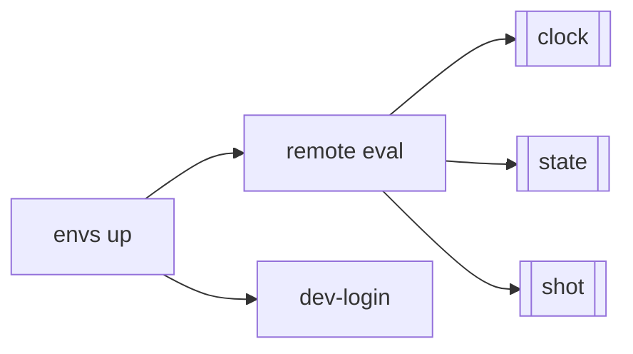
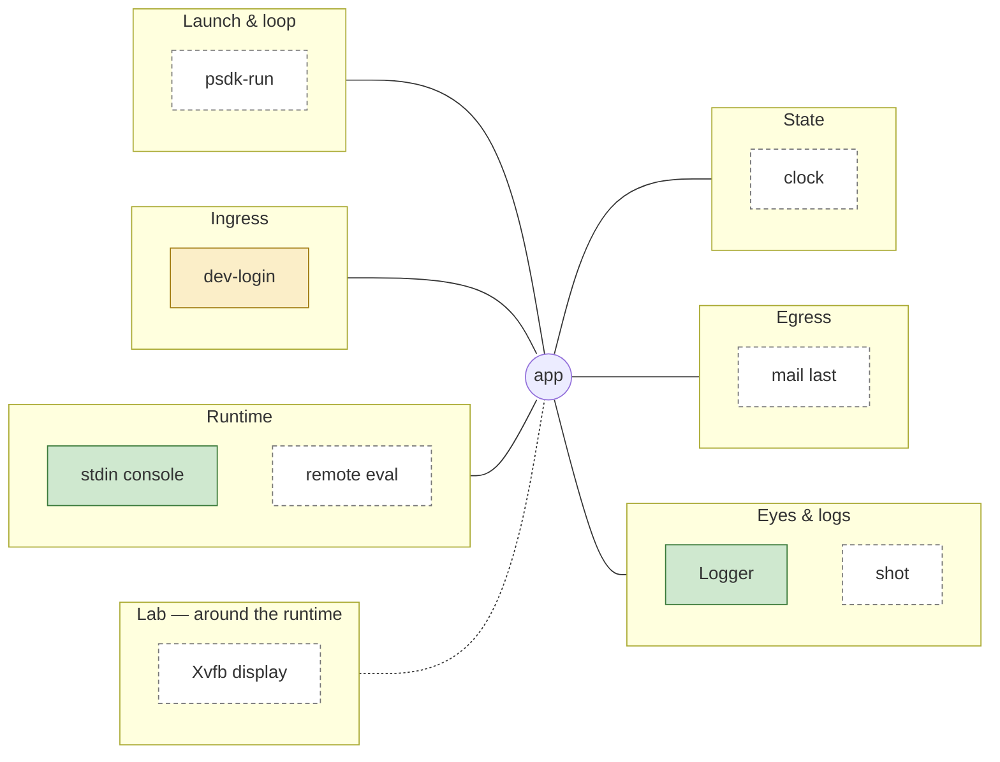

# Agent map — <project> @ <commit> (<date>)

## Contents
- Parallel agents
- Tools already in place
- Capabilities
- Delivered handles
- Candidate handles (not built)
- Deferred handles
- Roadmap
- Transferable patterns
- Rules → guards
- Fences to set first
- Diagram
- Points
- Classes with no point
- Unknowns
- Decisions
- Revisions
- Accepted plan
- Grill
- Noticed in passing

**Shape(s):** <…> · **Repos covered:** <…> · **Mapped by:** <agent>, grilled with <who>

**Variants:** <the ways this app runs that support different handles — e.g. the shipped runtime vs
a local build of it, two render backends, debug vs release; one line each, and which handles
exist only on one of them. Omit when there is one way to run it.>

**In one paragraph:** how well an agent can reach this app today, and the two or three capabilities that would change that most.

## Parallel agents

**Agents that can safely work at once today: <n>** — <one line: what stops the next one>.

| Shared resource | Shared by | What collides | Isolation today | Proposal (level 1 · 2 · 3) |
|---|---|---|---|---|
| Postgres `app_dev` | every worktree | seed rows; the `app_settings` clock row (global) | none | level 1: schema per env; the clock row becomes per-env |
| port 3000 | every dev server | the second server fails to start | none | level 2: port derived from `--env` |

## Tools already in place

Every handle an agent could already call **before toolsmith built anything**, with its category
(launch · ingress · runtime · state · egress · eyes · lab). A tool that climbs several ways gets one
row per verb. A handle toolsmith builds is not added here: its card moves to Delivered handles.

| Tool | Category | Verb | Way | Point(s) | Usage |
|---|---|---|---|---|---|
| <effect ledger> | egress | check | witness | B5, B6 | `bun run assay:check run.log --require <op>` |
| <stdin console> | runtime | steer, see | reach in | B3 | type a Ruby line in the game's terminal |

## Capabilities

The backbone of the roadmap: what the agent **cannot do today** on this project, named before any
card. Two to five, each a thing the agent can do once it is delivered — "reach any screen as any
persona, unattended" — never a tool or a handle name ("Playwright", "`dev-login`"). Each rests on
evidence from the survey: a point, a task that needed it, a human step in an agent file. Handles
are the means; every card serves a capability through the milestone that builds it, and a card no
capability needs is not proposed.

| # | Capability — the agent can… | Today | Evidence |
|---|---|---|---|
| C1 | run the loop unattended: launch an isolated copy, reach a state, see it, check it | a human starts the server and reads the screen | no launch script; `README.md:14` "open localhost:3000" |
| C2 | reach any state as any persona, at any time | ad-hoc seeds; login typed by the human | B9 `db/seeds.rb` personas, no session mint; 35 `Time.now` reads (B8) |
| C3 | check what left the app | mail goes through the live provider | B6 `lib/mail.ts:26` |

**Today** says what happens instead: a human step, an ad-hoc script, or nothing. Each capability
is delivered by one or more milestones, or listed under the roadmap's Deferred with why.

## Delivered handles

Cards toolsmith built, moved here from Candidate handles when they were delivered — never left
under the candidates, where they would read as proposed work. Same card grammar, with
**Status:** `delivered` and a mandatory **Verified:** line (see "Status and evidence" below). Empty
until the first build.

## Candidate handles (not built)

The map's main output. Group by way; finish what the project half-has before inventing. If no
external tool fits, say so in one line ("no tool fits: considered Storybook, motu — Vue 2").
**Card heading grammar** — the review page reads it, so keep it exact:
`### \`<name>\` — <category>[ (+ <category>…)] · <B-class> <name> · <verbs> · <way> · cost <S|M|L>`
(categories: launch, ingress, runtime, state, egress, eyes, lab). Group headings without that
shape (`### Reach in`) are allowed and ignored.

**Scripts under a primitive** go in its card as a table the review page reads:

| Script | Usage → prints | Needs |
|---|---|---|
| `press` | `run press Enter 3` → `{"pressed":"Enter","frames":3}` | an input-injection API in the engine |

A card may add a **Variants:** line when it exists only on some of the ways the app runs. A
handle that is pure configuration (env vars, a flag on an existing command) is still a card: its
**Is:** says so ("an env preset for the existing auth-proxy"), and its usage block shows it in use.
An **existing** handle that is itself a hazard (a debug port open in release) is listed in Tools in
place *and* gets a card to finish it — its missing fence is the work.

**Status and evidence.** Every card carries a **Status:** line, and the section matches it:

| Status | Section | Means |
|---|---|---|
| `proposed` | Candidate handles | on the map, not yet accepted |
| `accepted` | Candidate handles | in the accepted plan (dated), not started |
| `in progress` | Candidate handles | being built; say what is done |
| `delivered` | Delivered handles | built and merged; **Verified:** required |
| `deferred` | Deferred handles | not now; **Deferred because:** required |

**Verified:** `<level> — <evidence>` — keep the three levels apart, never round one up:
`implemented` (the code exists, nothing was run) · `tested` (focused tests or the usage example
ran: which, and what it printed) · `demoed` (it ran end to end against the live app: the command
and the date). A caveat follows a `;`: `tested — 4 unit tests pass; live demo deferred: no display
on the CI box`.

Three lines are mandatory on every card besides the usage block. **Is:** what you would actually
build and where — a new CLI in `tools/`, a public API in the engine plus its binding, an env flag
read by the backend, a file in `scripts/agent/`. **Not a script because:** for any card that is not
a script under a primitive, which of the exemptions applies (principles.md); no exemption, no card — it becomes a script line under the primitive. A handle owned by
a **lower layer** (the engine under a game, the runtime under an app) is not a card in this map: list
it as **Uses:** `<handle>` (from `<that layer>`'s map — or "to propose in `<that layer>`" when it has
no map yet) on the cards that depend on it. And a
**Parallel:** line: how the handle isolates two agents running it at once, or why it cannot; a
**Permission:** line: allow · ask · deny in the agent's harness. Size the usage output for an
agent: what the command prints by default, short.

One card per handle — the usage block is mandatory, and it is what makes it a handle: if the
agent never calls it (an untracked file, a default, a lint rule, a CI step), it is not a card —
it is a Fence or Needs line of the handle it serves, or one of the Fences to set first.

### `dev-login` — ingress · B9 Identity · steer · reach in · cost S
**Status:** proposed
**Finishes:** the seeded personas in `db/seeds.rb` (or **New**)

```sh
$ bin/dev-login --as stranger
{"user":"stranger","cookie":"_app_session=…","expires":"2026-11-18T10:00:00Z"}
```

**Is:** a new CLI, `bin/dev-login`, over the auth provider's local admin API — not app code.
**Gives the agent:** any persona's session in one command, no password typed.
**Not a script because:** it must work before any eval primitive exists in the process (it mints the session the browser starts with).
**Origin:** map (or `task "<…>"`, `want "<…>"` — and `Seen in:` the tasks that needed it).
**Needs:** two seeded personas (`stranger`, `admin`) in `db/seeds.rb`. (A Needs line may name another card: `Needs: dev-up`.)
**Fence:** refuses unless `RAILS_ENV=development` and the server binds `127.0.0.1`.
**Parallel:** `--env` (default: the worktree's) selects the server; sessions are per env.
**Permission:** allow (read-only against the agent's own env).

### `remote eval` — runtime (+ ingress) · B3 Runtime · steer, see · reach in · cost M
**Status:** accepted (2026-11-18, M1)
**Finishes:** **New** (remote debug already possible: `debug` gem in the Gemfile)

```sh
$ printf 'dev-token\nUser.count\n' | nc 127.0.0.1 7778
rubyvm-eval/1 token?
OK
=> 1342
```

**Gives the agent:** live state of the running server without pausing it.
**Fence:** development only, loopback, token required.

Unranked unless a task or the human's priorities were given: <priorities, if any>.

## Deferred handles

Cards kept but not planned, out of the candidates so they never look like open work. Same card
grammar, with **Status:** `deferred` and two more lines:

### `mail last` — egress · B6 Egress · see · witness · cost S
**Status:** deferred
**Deferred because:** the mail driver still falls back to live (Fences to set first, ⚠ 1).
**Revisit when:** the preview driver fails closed.

```sh
$ app-dev run mail last --to stranger@example.test
{"subject":"Your magic link","link":"http://127.0.0.1:3000/auth/…"}
```

## Roadmap

**Foundations** — bases several cards build on; built once, first.

| Foundation | Used by | Unlocks | Cost |
|---|---|---|---|
| `remote eval` (the primitive) | scripts `clock`, `state`, `shot`, `press` | runtime + ingress, and every script after | M |
| per-run environment (`envs up`) | `dev-login`, `remote eval`, `shot` | parallel agents; no writes in the human's tree | S |



**Milestones are cut by capability.** Each milestone delivers one capability (or a deeper step
of one), named first; its demo proves the capability, not just that the handles run. The cards
it builds are the means.

Every milestone has the same lines, one per line; the review page reads them:

- **Capability:** `C<n>` — the capability it delivers, from the table above.
- **Status:** `proposed` · `accepted` · `in progress` · `delivered`.
- **Builds:** the cards, by their exact names in backticks, and the scripts it adds.
- **Depends on:** the milestones it really needs, each with what it needs from it — or `none`.
  Numbering is the suggested order, **not** a dependency: two tracks that do not need each other
  both say `none` (or name only what they share), and the page shows them as independent.
- **Demo:** the command the agent runs once the milestone is built. **Expect:** what it observes
  when the demo works — the output, the screenshot, the row — concrete enough to fail.
- **Verified:** once anything is built, with the levels of the cards (`implemented` · `tested` ·
  `demoed`) and the caveats. A milestone is `delivered` and demoed only when its **Demo** ran end
  to end; if it did not, say so — `tested — focused tests pass; live demo deferred: <why>` — and the
  page shows it as not demoed.

### M1 — walking skeleton · keystone
**Capability:** C1 — run the loop unattended.
**Status:** accepted (2026-11-18)
**Builds:** per-run environment, `remote eval`, scripts `state`, `shot`.
**Depends on:** none.
**Demo:** `envs up a1 && app-eval --env a1 run state && app-eval --env a1 run shot home`
**Expect:** `state` prints the seeded counts as JSON; `shot` writes `shots/home.png` showing the dashboard — no human step.
**Why first:** every later card is a script on these two foundations.

### M2 — reach any state
**Capability:** C2 — reach any state as any persona, at any time.
**Status:** proposed
**Builds:** `dev-login`, scripts `clock`, `press`.
**Depends on:** M1 — `remote eval` runs the `clock` script.
**Demo:** `bin/dev-login --as stranger && app-eval run clock +47h && app-eval run shot reminders`
**Expect:** `shots/reminders.png` shows the 48-hour reminder banner for the stranger.

### Deferred

One line per deferred capability, milestone or card, by name, with why; the cards themselves are
under Deferred handles.

- C3 — check what left the app: waits for the mail fence (`mail last`).
- `mail last` — waits for the mail fence.

## Transferable patterns

Optional, at most three: an idea from this project that another project could reuse. Describe the
**capability**, not the tool: what it does, the evidence it matters here, what a project needs
before it fits, and where it does not. Write it in terms another stack could implement — this
project's framework, file names and team conventions stay in the Evidence column. A pattern that
an existing or proposed handle already embodies names that handle or capability in **Here as**;
it is never a second card. These patterns look outward; they do not set this project's roadmap —
the Capabilities do.

| Pattern | Does | Evidence here | Fits when | Does not fit when | Here as |
|---|---|---|---|---|---|
| test-impact selection | runs only the tests a change can reach | `bin/test --changed` cut the suite from 9 min to 40 s (`bin/test:12`) | a dependency graph from code to tests is cheap to compute | tests share global fixtures, or the graph is dynamic (plugins, reflection) | `test` handle, `--changed` |

## Rules → guards

Rules the agent files state in prose, and the guard each could become.

| Rule (where) | Guard | Kind |
|---|---|---|
| "NEVER run `supabase db reset`" (`CLAUDE.md:7`) | pre-tool hook blocking the command, with the reason | hook |
| "use the service layer for DB access" (`CLAUDE.md:9`) | lint rule on imports of the client outside `services/` | lint |

## Fences to set first

At most five, one line each: what an agent's probes or handles here could trigger with real
consequences, and the fence that makes the handles above safe to use.

| ⚠ | Fence | Evidence | Why it matters to an agent |
|---|---|---|---|
| 1 | mail driver falls back to live | `lib/mail.ts:26`, `RESEND_API_KEY → live` | a local serve would email real people — make it fail closed before any handle uses mail |

## Diagram

The app in the middle, the six categories around it, one node per handle: **solid** = exists
(in place before, or delivered), **amber** = half-built (a card that *Finishes* something),
**dashed** = missing (a card marked New). Deferred cards are left out of the diagram. One node per
handle, not per row: a tool listed once per verb is one node, and a tool a card *Finishes* is
drawn only as that card. This is the picture the human reads first — keep node labels to the handle's name.



A category with no handle at all is still drawn, empty — that gap is the finding.

## Points

The survey behind the picture: one line per point, grouped by boundary class. Keep it compact —
the cards above carry the detail.

- **B6 Egress** — mail provider · `lib/mail.ts:42` · see ✓ preview table · stub ~ falls back to live · existing: preview driver (fails closed ✗)

Verb values: `✓ <how>` · `~ <friction>` · `human` · `✗` missing; add `(seen)` or `(docs)` where it
applies. Cross-referenced points: `→ B7`.

## Classes with no point
- B10 Platform — none found (looked at: …)

## Unknowns
- <point>: <what could not be determined> → asked <who> / owner

## Decisions

What the human decided while reviewing this map (grill answers, remarks), dated — applied below.

## Revisions

One entry per revision: what changed, and which remark caused it.

## Accepted plan

Filled only after an explicit go: the handles to build, in order, with the decisions they rest on.
Set **Status:** `accepted` on those cards and milestones at the same time.

## Grill

At most three, each one changing which handle gets built; each with your recommended answer.

## Noticed in passing

One line, optional: security issues in the app itself that are not about the agent's loop
(not the map's job — say where you saw them and move on).

